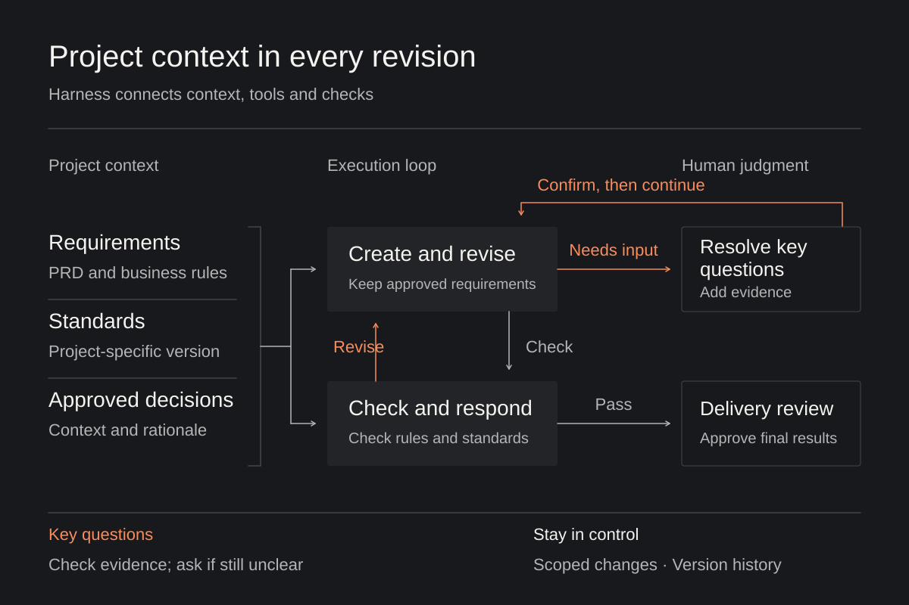
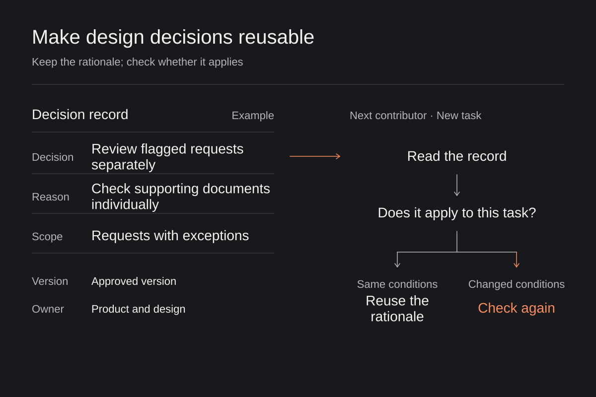

# What AI Tools Does a Design Team Need?

From understanding requirements to sharing knowledge across a team

From understanding requirements to sharing knowledge across a team

In Fleet and safety projects, AI has already become part of producing design drafts. Product managers provide the PRD, designers add standards and project background, and the generated proposals are refined through further iterations. This workflow offers a concrete starting point for improving design efficiency.

**AI tools suited to a team should help people clarify requirements, compare options, and work with product and engineering to deliver. What a team learns in one project should also make the next project easier.**

Different tools can provide these capabilities together. When choosing or building tools, the questions are how they take part in real tasks and how one team member can pick up where another left off.

## Help the team understand the requirements first

A PRD gives design a starting point. Designers still need to understand the user's underlying goals and check whether the business rules are complete. When requirements are ambiguous, generating screens immediately carries unconfirmed assumptions into the proposal and affects later revisions.

At this stage, AI can organize the material and identify information gaps. In an approval flow, for example, designers first need to establish who can approve a request and what happens after a rejection. A tool can compare the requirements with the rules provided, list what is missing, and clearly distinguish evidence from its own assumptions. Product and design can then resolve those questions early. The tool should never present an assumption as a confirmed requirement.

Prototypes can also help a team discuss requirements before everything is clear. Some design research has explored [generating prototypes during interviews from participants' descriptions](https://edges.ideo.com/posts/a-human-centered-framework-for-using-ai-in-design-research). Participants respond to a concrete proposal, and researchers use those responses to ask further questions. The prototype becomes a way to understand the need. This approach is useful, but designers must still judge whether the feedback is sufficient to support the next decision. While the discussion is about needs and flows, a prototype can remain visibly unfinished to leave room for different views.

## Let different roles make decisions around a proposal

As requirements become clearer, design moves into exploring options. AI can produce initial drafts quickly, giving a team an earlier opportunity to compare different approaches. But if everyone accepts the first version too quickly, the scope of exploration remains narrow.

Tools for this stage should make it easy to keep several directions and compare their information structure and interaction flows. In the approval example, individual and batch approval could become two prototypes, allowing the team to compare operating efficiency with the risk of mistakes. Designers need to explain the problem each direction addresses and the trade-offs it entails. Each round should focus on answering one specific question.

For a team tool, sketches, interactive prototypes, and delivery-ready designs all need a place. To discuss whether information is easy to find, start with the structure. To assess whether a key action works smoothly, use an interactive prototype. The tool should let the team choose the right level of representation for the question.

**The easier proposals are to view and modify together, the earlier different roles can contribute to decisions.** Product clarifies goals and priorities, designers assess experience trade-offs, and engineering explains implementation constraints. Tools should attach feedback to the relevant proposal and preserve confirmed decisions, reducing the need to explain the same things again later.

This also makes the designer's professional responsibility clearer: choose which directions to compare, organize feedback, and explain why the selected proposal is worth pursuing.

## Keep refining within project constraints until delivery

Once a direction is chosen, tools need to support progressive refinement. In real projects, a proposal must follow business rules and continue the existing design language. Generating a first version is only the beginning.

In practice, PRDs often run to tens of thousands of Chinese characters. Add historical context and design standards, and context capacity becomes a practical requirement. Once the material fits, the next challenge is keeping relevant requirements active throughout every revision. A designer changing one interaction should not have to repeat the project background that was already established.

Tools need to retrieve relevant material for the task and identify its source, scope, and version. Design standards can be organized as readable component documentation and usage rules; research findings and key decisions should retain their supporting evidence. Interfaces such as MCP can help tools access that material, but the team still needs to determine what applies to the current project. A project committed to one component-library version should not necessarily switch automatically when the standards change. Versioned static documentation can also be a reliable reference.

Here, Harness refers to the operating mechanisms around a model that organize context, call tools, and check results. It should bring the requirements relevant to the current task to the model, so revisions carry earlier decisions forward. If missing information or conflicting rules affect a key judgment, it should first look for existing evidence. Only what remains unresolved should be referred to a person. After execution, designers should be able to understand the basis for a change and correct it easily.

Early exploration focused on whether generated output could be imported into professional design tools for further refinement. In the scenarios tried later, continuing to refine directly within an AI tool could also meet delivery requirements. This shifted attention toward whether changes are controllable and results meet the required standard. Other projects still need to decide whether to use a professional design tool according to their own delivery requirements.

AI tools should give designers explicit control over the scope of a change. They should be able to modify a selected area while preserving confirmed content, and return to an earlier version when a change is unsatisfactory.

Project context informs every revision, and check results guide the next adjustment. People can clarify decisions or take over during execution.

## Make effective practices reusable across the team

Someone familiar with a project knows what context to provide and how to assess generated output. Other members need access to those same references to use the tool successfully. Shared, maintained team knowledge therefore matters.

Beyond components and visual standards, useful material includes user research findings and the reasons behind major design choices. These should become project resources that AI can access, helping it understand why a rule exists. Later contributors then have a shared design reference they can consult and update. Keeping this material useful requires clear ownership. When standards change, their scope must be explicit so the tool uses the version confirmed for the current project. Superseded decisions should be marked accordingly.

Preserve the reasoning and conditions behind a decision, so later contributors can tell when to reuse it and when to check again.

Tool adoption also needs a sequence. Start with frequent tasks whose requirements are reasonably clear, document the necessary context and steps, and let other members try them. In that process, [effective individual practices need to become shared team methods](https://www.figma.com/blog/2026-ai-report/). Difficulties encountered by members should then inform improvements to both the tool and its guidance.

Evaluation should consider a complete task. Whether the proposal meets requirements, how much rework is needed before delivery, and whether product and engineering must keep explaining the same things all affect the actual benefit. Sustained adoption also depends on whether other members can complete tasks independently and how much effort is needed to maintain shared resources.

| Dimension | Key question | What to observe |
| --- | --- | --- |
| Task outcome | Does it meet delivery requirements? | Requirements met; rework effort |
| Collaboration | Does it reduce the overall workload? | Repeated explanations; checking and communication effort |
| Sustained adoption | Can other members keep using it? | Independent task completion; documentation upkeep |

Assess task outcomes, collaboration, and sustained adoption to decide whether further investment is worthwhile.

Investment decisions should follow these questions too. Adopt existing tools when they can do the work reliably. Connect or configure them to supply the team's specific standards and project context. Building a custom tool is justified when a problem keeps recurring and existing approaches struggle to solve it.

Tool development should create more room for considered design decisions. Let AI handle repetitive generation and revision, and use the time saved to clarify requirements and compare options. Preserve the design reasoning already established in a project so that others can build on it.

**AI tools suited to a design team should help the team understand why a design takes its form, and reliably carry those decisions into the product.**
