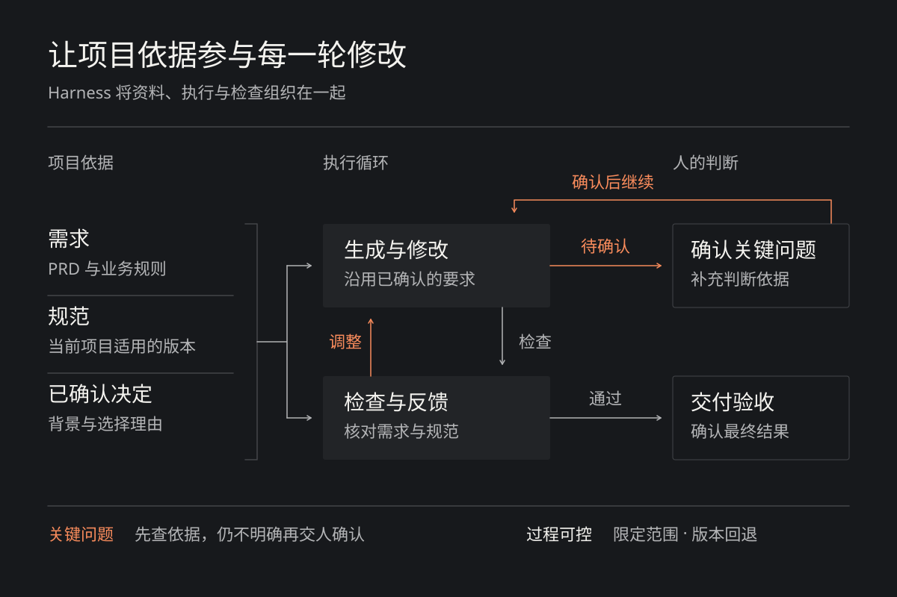
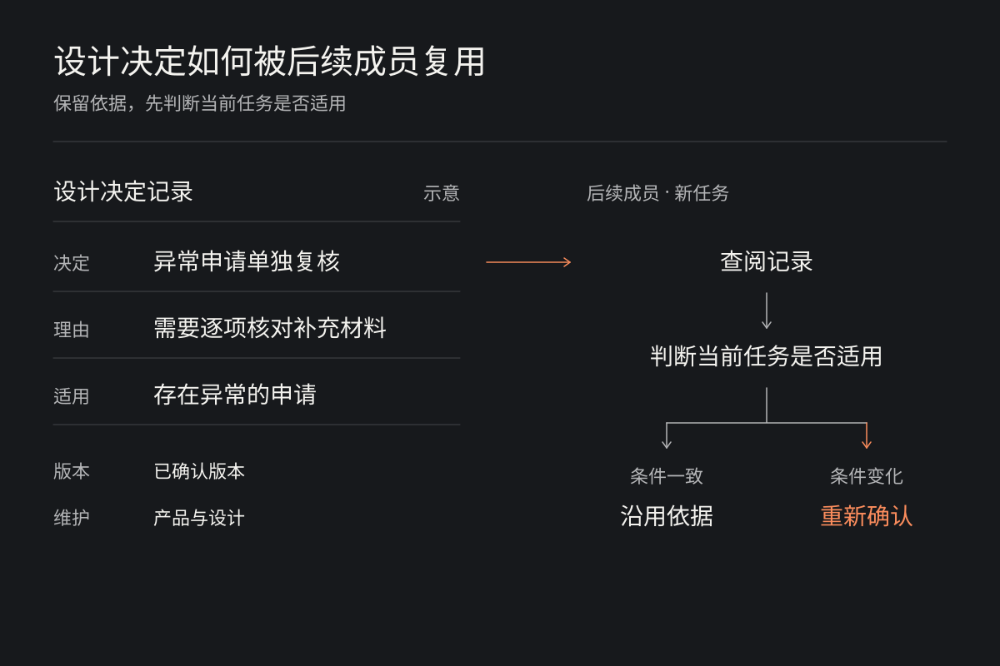

# 设计团队需要怎样的 AI 工具

从需求理解到团队复用

在 Fleet 和安全项目的实践中，AI 已经参与到设计稿的生成。产品经理提供 PRD，设计侧补充规范和项目背景，再围绕生成的方案持续调整。这条路径为设计工作提效提供了一个具体切入点。

**适合团队的 AI 工具，应当帮助成员弄清需求、比较方案，并与产品和研发共同完成交付。一个项目中形成的经验，也应该让后续工作更容易开展。**

这些能力可以由不同工具共同提供。选择或自建工具时，需要关注它们如何参与实际任务，以及成员之间如何接续工作。

## 先帮助团队把需求想清楚

PRD 为设计提供了起点，设计师还需要理解需求背后的用户目标，检查业务规则是否完整。当需求中存在歧义时，直接生成页面会把尚未确认的理解带进方案，后面的修改也会受到影响。

AI 可以在这个阶段帮助团队整理资料，指出信息缺口。以审批流程为例，设计师需要先确认审批权限，以及被驳回后的处理方式。工具可以对照需求，把缺少说明的规则列出来，并明确区分已有证据与自行补充的推测，方便产品与设计提前确认。它不应把假设当成确定的需求。

需求还没有完全清楚时，也可以先借助原型帮助讨论。已有设计研究尝试[在访谈中根据参与者的描述即时生成原型](https://edges.ideo.com/posts/a-human-centered-framework-for-using-ai-in-design-research)，让对方对着具体方案表达意见，研究人员再继续追问。原型由此成为理解需求的一种方式。这种做法值得借鉴，但设计师仍然需要判断，这些反馈是否足以支持后续决定。当讨论重点仍是需求和流程时，原型可以保留未完成的状态，给不同意见留下空间。

## 让不同角色围绕方案做判断

需求逐渐明确后，设计工作进入方案探索。AI 能够快速生成初稿，团队也因此有机会更早比较不同路径。但如果大家很快接受了第一版，探索的范围仍然有限。

适合这一阶段的工具，应当方便团队保留多个方向，并比较它们在信息组织和操作流程上的差异。沿用审批流程的例子，可以把逐条审批和批量审批做成两版原型，让团队比较操作效率与误操作风险。设计师需要说明每个方向准备解决什么问题，以及选择它要接受什么取舍。每一轮先集中回答一个具体问题。

对于团队工具，这意味着草图、可操作原型和交付稿都应有各自的位置。讨论信息是否容易找到时，可以先看结构；确认关键操作是否顺畅时，再使用可操作的原型。工具需要允许团队按问题选择合适的表达方式。

**方案越容易被共同查看和修改，不同角色就越有机会提前参与判断。** 产品负责解释目标与优先级，设计师判断体验上的取舍，研发补充实现条件。工具应当把讨论意见与对应的方案关联起来，并保留已经确认的决定，减少后续重复解释。

设计师的专业责任也因此更清楚。需要决定比较哪些方向，组织反馈，并说明最终方案为什么值得继续推进。

## 在项目约束下持续修改到交付

方向确定以后，工具需要支持细节逐步完善。对于真实项目，方案要遵守业务规则，也要延续已有的设计规范。生成第一版只是这一过程的开始。

在实际使用中，PRD 经常达到几万字，再加上历史背景和规范，上下文容量是一个现实要求。资料能够放进去之后，还要保证相关要求在每轮修改中继续生效。设计师修改一处交互时，不应该反复补充此前已经确认的项目背景。

工具需要能够按任务查找相关资料，并识别资料的来源、适用范围和版本。设计规范可以整理成可读取的组件说明与使用规则，研究结论和关键决定也应保留明确的依据。MCP 等接入方式可以帮助工具获取这些内容，团队仍需负责确认哪些资料适用于当前项目。已经确认使用某版组件库的项目，未必应该在规范更新后自动切换；带版本的静态资料同样可以是可靠依据。

这里将模型周围组织资料、调用工具和检查结果的运行机制称为 Harness。它应当把当前任务相关的要求交给模型，让修改延续已有决定。当缺失的信息或规则冲突影响当前任务的关键判断时，先查找已有依据；仍无法确定的部分，再交给人确认。执行之后，也应让设计师理解改动的依据，并能方便地纠正结果。

早期曾重点考虑，生成结果能否导入专业设计工具继续精修。后续在已经尝试的场景中，直接通过 AI 工具持续调整，也能够满足交付要求。这让工具选择更关注修改是否可控、结果是否达标。其他项目仍需依据各自的交付要求，决定是否进入专业设计工具。

AI 工具需要让设计师明确地控制修改范围。比如，只调整指定区域，保留已经确认的内容；改动不符合要求时，能够回到之前的版本。

*项目资料参与每轮修改，检查结果用于下一步调整。执行过程中也可确认和接管。*

## 让有效做法在团队中持续复用

一个熟悉项目的人，知道该补充哪些背景，也知道怎样判断生成结果。其他成员要顺利使用工具，就需要能够找到这些依据。团队共同维护的知识因此变得重要。

除了组件与视觉规范，还值得保留用户研究结论，以及关键方案的选择理由。这些内容应整理为 AI 能够调用的项目资料，帮助它理解规则背后的原因。后续成员使用工具时，也就有了可以共同查阅和更新的设计依据。要让这些资料长期有用，需要明确维护责任。规范更新后，需要明确适用范围，让工具使用当前项目已确认的版本；已经失效的决定，也应作出标记。

*保留决定的理由与适用条件，让后续成员能够判断何时沿用、何时重新确认。*

团队采用工具也需要有推进顺序。可以先选择高频、要求相对明确的任务，把所需资料和操作步骤整理清楚，再让其他成员尝试使用。在这个过程中，[个人探索出的有效做法需要变成团队共同使用的方法](https://www.figma.com/blog/2026-ai-report/)。成员遇到的困难，则应继续用于改进工具和说明。

评价时，应当把一次完整任务放在一起看。方案是否符合要求，交付前需要多少返工，产品与研发是否仍要反复解释同一件事，都会影响实际收益。持续采用还取决于其他成员能否独立完成任务，以及维护公共资料需要投入多少精力。

| 评价维度 | 核心问题 | 观察重点 |
|---|---|---|
| 任务结果 | 能否达到交付要求？ | 需求满足、返工成本 |
| 协作过程 | 是否减少整体负担？ | 重复解释、检查与沟通投入 |
| 持续采用 | 其他成员能否持续使用？ | 独立完成任务、资料维护成本 |

*从任务结果、协作过程和持续采用，判断工具是否值得继续投入。*

对工具投入的判断也应沿着这些问题展开。已有工具能稳定完成的工作，可以直接采用；团队特有的规范和项目背景，可以通过接入与配置补充。只有那些反复出现、现有方式又难以解决的问题，才值得投入自建。

工具建设要为更充分的设计判断创造条件。让 AI 承担重复的生成与修改工作，把省下来的时间用于确认需求和比较方案；同时保留项目中已经讨论清楚的设计依据，让其他成员能够接着使用。

**适合设计团队的 AI 工具，应当让团队更清楚地知道为什么这样设计，并把这些判断可靠地落实到产品中。**
