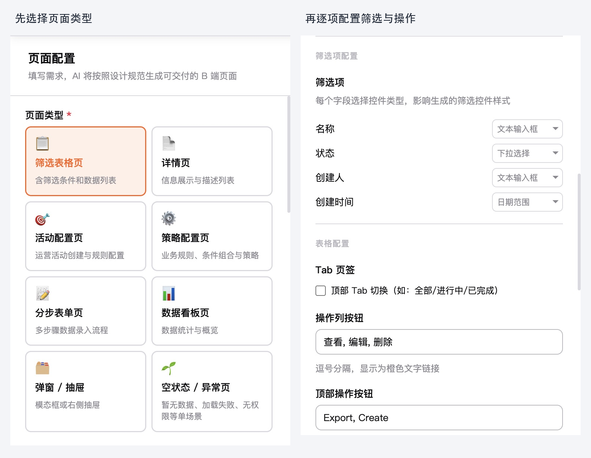
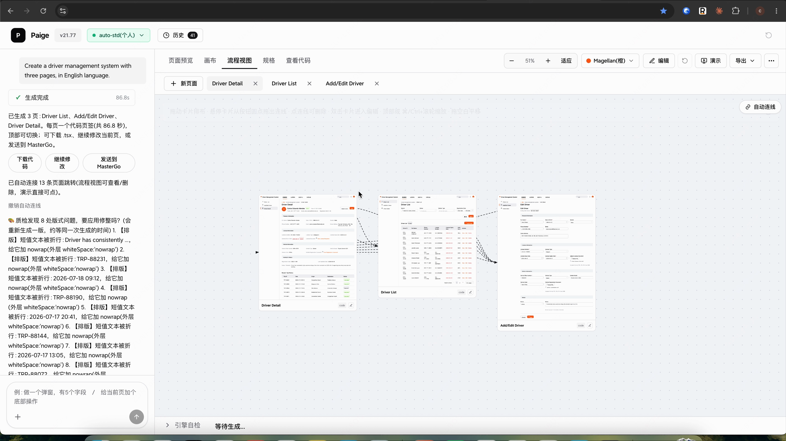
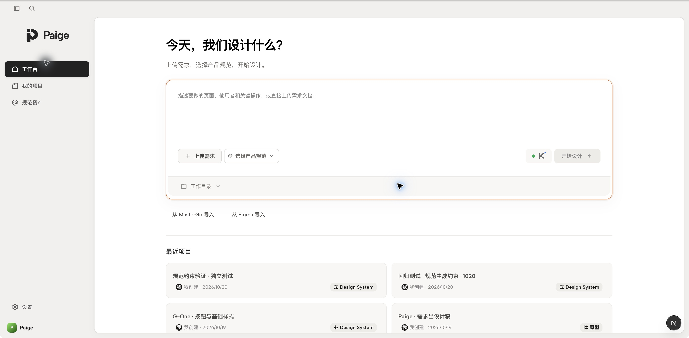
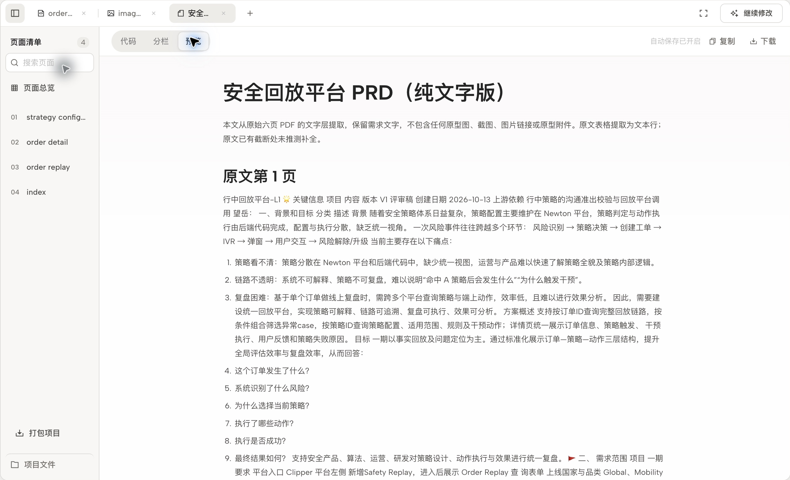
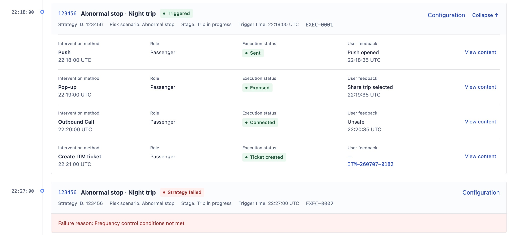

# A year of Paige: from configuring pages to designing from requirements

**As models improve, the way we work with AI changes too**

> **Project overview**
> Project: Paige, an agent for generating business interfaces. A sentence or PRD becomes several related, interactive pages that can be revised within the same project.
> Role: Built independently, from identifying the problem and designing the product and interactions to implementing it with AI and rebuilding it several times.
> Timeline: Started in early 2026; moved toward component-code generation in July; rebuilt on an open-source tool in October. The new version is currently being tried and validated locally.
> Results: Selected for the IBG (DiDi International Business Group) outstanding AI projects showcase and placed first in the individual category of the 2026 IBG AI Innovation Challenge. One text-only PRD and two reference images produced three connected pages: order replay search, order details, and strategy configuration.

At the start of this year, making a table page with Paige meant choosing a page type and configuring every filter, column, and button.

Now, a PRD and two reference images can become three related pages for search, details, and strategy configuration, with basic interactions and continued editing in one project.

Paige has taken on more work while asking people to configure less. Several major revisions made that possible. Each improvement in model capability called for another look at which decisions still needed to be specified by hand.

## Start with one usable page

The first version addressed a concrete part of business interface design.

Lists, forms, detail pages, and dialogs often share basic structures. A new requirement still means arranging components, filling in fields, and adjusting styles again. I wanted AI to take on some of this repetitive work.

Early in the year, models and AI tools were less mature. Giving them complex requirements directly often left a substantial gap between the output and what was needed. I narrowed the task to common page types and built a semi-automated configuration tool.

For a table page, a person specified the filters, their controls, and the buttons in the action column. Common component styles, colors, and type sizes were prepared beforehand, then used with the company's design standards to generate the page.

The preserved v18 version shows the earlier workflow: choose a page type, then configure filters and buttons.

A person still planned the page and translated that plan into configuration the tool could understand. AI built it. Clearer limits made useful output more likely and gave Paige a usable first version.

## More understanding, less configuration

As models became better at natural language, many choices could be described instead of selected manually.

I added natural-language input so AI could identify fields and choose controls. The entry point gradually became a single input box. Later, input expanded from a sentence to a PRD; AI began reading the requirements and splitting them into pages, extending the task from one page to several.

An older demo takes an English requirement for a three-page driver management system and produces interactive pages. Elements can then be selected and components changed before importing the result into MasterGo, an online UI design tool, for further work.

An original frame from the earlier recording: a driver management requirement generated three pages.

Paige was subsequently selected for the IBG outstanding AI projects showcase and placed first in the individual category of the department's 2026 IBG AI Innovation Challenge.

Simpler input exposed structural limits. Common requirements fit the templates; complex business workflows did not always fit. A page might need a table, a side detail panel, and configuration controls, with content changing as the user interacted. Anything outside the template required another addition.

By June, I kept returning to the same question: how could this configuration approach cover the different structures across the company's business products?

## When AI can organize pages, the tool needs rebuilding

In July, Paige began moving toward generating code directly with Pebble, the company's business component library. I gave the model more freedom to organize pages, then checked whether the code ran, used allowed components, and rendered appropriately. Fixed templates were no longer essential.

Freedom alone was insufficient; the material also had to be right. In August, Paige repeatedly omitted filters and dialog details when rebuilding an interactive vehicle management prototype. Working directly with AI and supplying the prototype code and component library preserved more of the business content and interactions.

Comparing the processes suggested that parts of Paige's workflow split and compressed the material, potentially leaving the model with incomplete information. A carefully divided sequence of calls does not guarantee that each step understands the business it handles. This comparison prompted a rethink of what to supply and where to constrain AI.

During the October rebuild, I reviewed several generations together. The old template engine remains a fallback but is no longer being extended. The new version builds on an open-source tool's project management, model calls, and preview capabilities, connecting company standards, result checks, and design methods learned from actual projects.

The new entry point centers on submitting requirements, choosing product standards, and starting design. Projects remain available for continued revision.

Initially, I controlled results by specifying page structure in advance. Models can now read fuller requirements, organize layouts, and write interfaces, so the tool should make use of those capabilities. More of my work goes into preparing business material and design requirements, letting AI propose a solution, and assessing the actual pages it produces.

## What one PRD and two reference images can produce

A real requirement tried in the new version makes its present capabilities concrete.

Users needed to find an order, review its timeline and triggered strategies, and inspect the relevant rules and interventions. I supplied a text-only PRD and two existing screenshots as references for blue navigation, component styling, and layout. Business content came from the PRD; AI organized the internal page structures.

The original PRD from this task, opened in Paige.

The resulting project contained order replay search, order replay details, and strategy configuration.

【视频：paige_demo.mp4】

Generated project walkthrough · 1920 × 1080 · Some actions sped up
Search an order → Open details → Expand records and dialogs → Open a strategy → Find related orders

Following an order from search to execution records and its strategy lets the business relationships be checked individually. Order details use a timeline, placing strategy triggers at their corresponding moments. Repeated executions of one strategy remain separate records, with expandable interventions, execution states, and user feedback. The three pages share consistent sample data.

A section of the order details: repeated strategy executions are recorded separately, with action status and feedback in context.

The new version accepts requirements or a PRD, product standards, and reference images to generate a multi-page project. Pages remain together for previews and targeted revision requests, with export for the current page or the entire project. For work requiring strict product standards, existing component definitions and variables can be imported as reference material for AI. One MasterGo batch import read 321 common component definitions and 109 variables, saving them as a draft for review. Programmatic checks are also part of the flow: a task is not shown as successful if checks have not run or errors were found.

This case uses sample data. The new version is still being tried and validated locally. Component usage guidance and business rules need further real-project input; interaction and design quality still require hands-on judgment.

## Help a project continue beyond its first draft

The immediate work is to improve complete standards usage, reliability on complex requirements, and checks after generation. Beyond that, I want Paige to contribute more to the work after the first draft.

A recent DeepSeek Harness Super-agent design exploration raised a useful question. As models take on more work, the attention people spend explaining context, following progress, and coordinating tasks also matters. Its official prototype documentation makes reducing human attention cost a design principle, with communication when there is a result, a decision to make, or a blocker. For Paige, time saved generating pages should extend into later revisions and reviews.

I want to connect work within a project first. When requirements change or review feedback is confirmed, Paige could use existing pages and business requirements to identify affected areas and prepare the next version. Changes and unresolved issues should be visible across versions. Designers could spend more time assessing proposals and less time reconstructing prompts.

Later, the reasons behind team decisions should remain too. Paige could help record why a review kept an action or when a component applies, with confirmation by the people making the decision. Similar tasks could reuse these records; changed users or business conditions should make it clear which assumptions need revisiting. Accuracy and the updating of stale records still need validation before reuse across projects.

I also want it to advance some work proactively, starting within explicitly permitted boundaries: checking for missing confirmed requirements and preparing changes to compare. Business rules and design trade-offs should bring the evidence and decision back to the designer. Hands-on use and feedback from users remain necessary.

These directions need gradual validation. Alongside generation time, I want to consider how often designers must repeat an explanation before a requirement becomes reviewable, and how much attention remains for design itself.

## Designers need to update their own division of work

I used to specify pages in detail before generation. AI can now organize a proposal from the requirements, leaving more attention for business completeness, clarity, and whether interactions work.

The judgment that has needed the most updating this year is how far AI can actually go. Useful constraints early in the year may need loosening months later. Steps that once required manual work deserve another try. Each change needs to be assessed through real tasks.

Team standards, components, and business knowledge have another use too. Designers previously applied them project by project; they can now also guide AI across many generated pages.

The work is still design. Its object has expanded from individual interfaces to how AI carries out design. Paige will keep changing, and I will keep reassessing that division of work.
