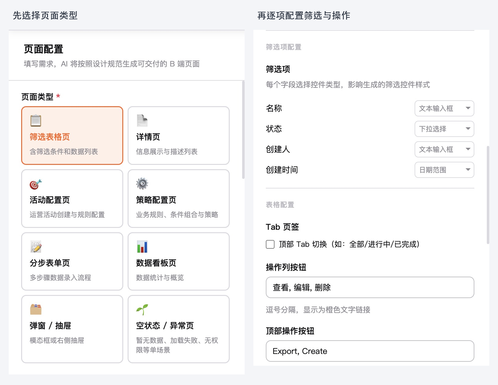
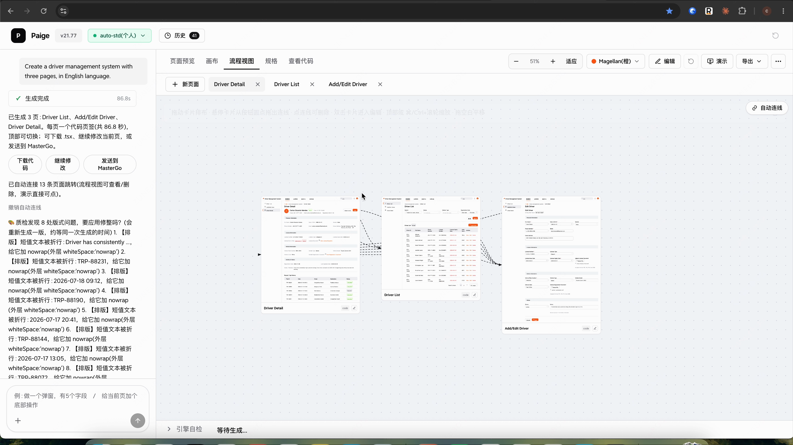
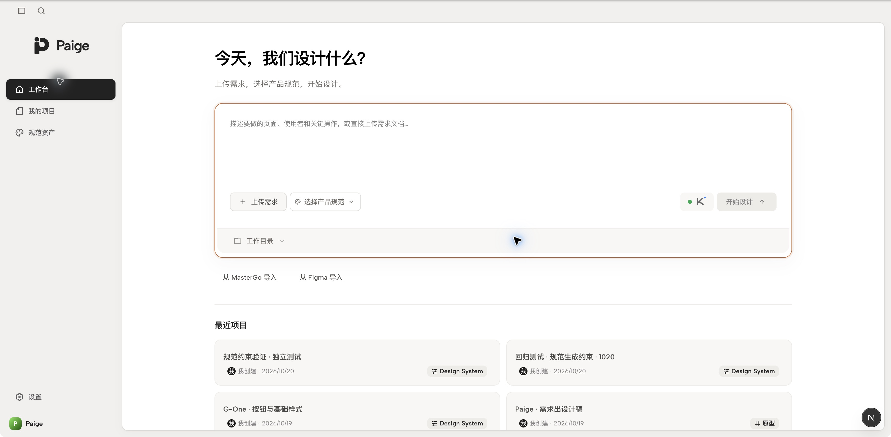
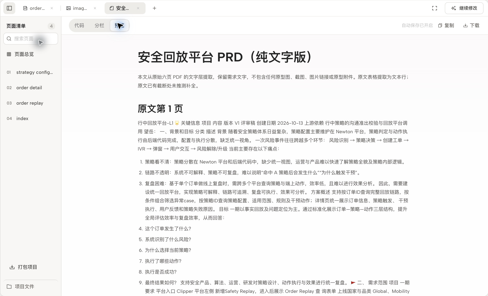
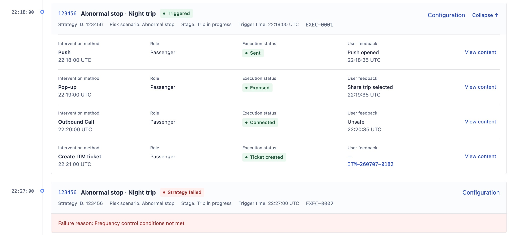

# Paige 这一年，从手动配页面到 AI 按需求做设计

**模型在进步，与AI的工作模式也在改变**

> **项目概览**
> 项目：Paige，B 端页面生成 Agent，从一句话或一份 PRD 生成多个相互关联、带交互的 B 端页面，生成后可在同一项目里继续修改。
> 角色：个人独立完成，从发现问题、产品与交互设计，到借助 AI 开发实现，并经历多次重构。
> 时间：2026 年初开始，7 月转向组件代码生成，10 月基于开源工具重构，目前新版在本机试用与验证阶段。
> 结果：入选 IBG（滴滴国际化事业群）优秀 AI 项目展示，在 2026 IBG AI 创新挑战赛中拿到个人第一；一份纯文字 PRD 加两张参考图，生成了订单回放查询、详情和策略配置三个关联页面。

今年年初，让 Paige 生成一张表格页，要先选页面类型，再把筛选项、表格字段和按钮逐一配好。

现在，我把一份 PRD 和两张参考图交进去，它已经能组织出查询、详情、策略配置三个相互关联的页面，带着基本交互，留在同一个项目里继续修改。

这一年，Paige 能做的事越来越多，需要人提前填的配置却越来越少。中间经历了几次大改版。模型每往前走一步，都需要重新判断，原来安排给人的工作有哪些可以交出去了。

## 年初，先把一张页面做出来

最开始做 Paige，想解决的是 B 端设计里很具体的一件事。

列表、表单、详情、弹窗，很多页面的基本结构相似。换一个需求，又要重新摆组件、填字段、调整样式。里面有不少重复工作，我希望能让 AI 帮忙做掉。

但年初的模型和 AI 工具，还不像现在这样成熟。直接把复杂需求交过去，离想要的结果往往有一段距离。我先把任务收小，从常见页面开始，做了一版半自动配置工具。

以表格页为例，要哪些筛选项，每项用什么控件，操作列放哪些按钮，都由人逐一指定。常用组件的样式和颜色、字号提前准备好，再结合公司的设计规范生成页面。

【插图 01：01_early_semi_auto_config.png】

重新打开保留的 v18 历史版本，展示当时先选页型、再配筛选项和按钮的工作方式。

那时候，页面怎么组织，仍然由人先想好，再翻译成工具认识的配置。AI 负责把它做出来。任务限定得越清楚，结果越有机会可用，Paige 也因此有了可以使用的第一版。

## 模型多理解一点，人就少配一点

后来，模型越来越能理解自然语言，很多原来必须手动选择的内容，可以直接描述了。

我给 Paige 加上自然语言输入，让 AI 从需求里识别字段、判断控件，入口逐渐收成一个输入框。再往后，输入从一句话变成一份 PRD，AI 开始先读需求、拆分页面，任务也从单页扩展到多页。

旧版的一段演示里，输入英文需求，要求做一个包含三个页面的司机管理系统，Paige 就生成了带交互的页面。生成后可以点选元素、更换组件，再导入 MasterGo（一款在线 UI 设计工具） 继续处理。

【插图 02：02_old_multipage_demo_frame.png】

旧版真实演示录屏原帧，司机管理需求生成了三个页面。

Paige 后来入选了 IBG 优秀 AI 项目展示，也在部门的 2026 IBG AI 创新挑战赛中拿到了个人第一。

输入变简单以后，原来的结构限制却更明显了。常见需求能放进模板，复杂业务未必适合。一个页面可能同时需要表格、侧边详情和配置区，还会随着操作状态切换内容。模板没覆盖到，就得继续补。

到了 6 月，我反复在想，公司有多个 B 端产品，页面结构各不相同，这套配置方式要怎样覆盖？

## AI 能自己组织页面以后，工具也要重做

7 月，Paige 开始逐步转向让模型直接生成公司的 Pebble 组件代码（Pebble 是公司的 B 端组件库）。我给它更多组织页面的空间，再检查代码能不能运行、是否用了允许的组件，以及实际渲染出来的效果，固定模板不再是必备需求。

不过，放开结构，还得把材料给对。8 月，我把一份带交互的车辆管理原型交给 Paige 重做，筛选项和弹窗细节反复遗漏。后来直接与 AI 协作，提供原型代码和组件库，反而保留了更多业务内容和交互。

回头检查两边的过程，Paige 当时的部分流程会拆分和压缩材料，模型拿到的信息可能已经不完整。调用步骤安排得细，并不代表每一步都能理解自己要处理的业务。这次对照让我开始重新考虑，该给 AI 什么材料，又该在哪里约束它。

10 月重构时，我把几代版本放在一起看。旧模板引擎保留作备用，不再继续扩展。新版本基于开源工具，复用它的项目管理、模型调用和预览能力，把公司规范、结果检查和实际项目里积累的设计方法接进去。

【插图 03：03_new_paige_workbench.png】

新版入口收成了提交需求、选择产品规范和开始设计，项目可以持续保留和修改。

早期，我靠提前规定页面结构来控制结果。现在，模型已经能读更完整的需求、组织布局并编写页面，工具也要让它用上这些能力。我更多地准备业务材料和设计要求，让 AI 先形成方案，再用实际页面检验它做得怎样。

## 一份 PRD 和两张参考图，现在能生成什么

在新版本中，有一个真实的需求进行了实践，能比较具体地说明现在的 Paige。

这项需求要让使用者查到一笔订单，沿时间线看清发生过什么、触发了哪些策略，再进一步查看策略规则和干预动作。我交给 Paige 的是一份纯文字 PRD，另外附上两张已有页面截图，提供蓝色导航、组件样式和排版参考。业务内容按 PRD 来，页面内部的结构交给 AI 根据需求组织。

【插图 04：04_input_prd.png】

同一次任务中的原始 PRD，在 Paige 中打开查看。

随后生成的，是订单回放查询、订单回放详情和策略配置三个页面。

【视频：paige_demo.mp4】

已生成项目操作演示 · 1920 × 1080 · 部分操作加速  
查询订单 → 进入详情 → 展开记录与弹窗 → 跳转策略 → 反查订单

沿着一笔订单完成查询、查看执行记录，再进入对应策略，需求里的业务关系就能逐项核对。订单详情把订单过程组织成时间线，策略触发记录放在对应的时间点，同一个策略多次执行会分别保留记录，干预动作、执行状态和用户反馈也能展开查看。三个页面使用同一组示例数据，前后能对应上。

【插图 05：05_result_strategy_exec_detail.png】

订单详情局部，同一策略的多次执行分别记录，动作状态和反馈放在对应位置。

现在的新版里，提交需求或 PRD 以后，可以选择产品规范、附上参考图，生成一个包含多个页面的项目。页面留在同一个项目里，可以预览，也可以选中页面继续提修改，再导出当前页或打包整个项目。需要严格遵守产品规范的任务，可以把团队已有的组件定义和变量导入，整理成供 AI 使用的规范材料；一次 MasterGo 批量导入已经读取了 321 个常用组件定义和 109 个变量，保存成待核对的草稿。生成后的程序检查也接进了流程，检查未执行或发现错误时，任务不会直接显示成功。

这次案例使用的是示例数据，新版目前也还在本机试用与验证阶段。组件适用场景和业务规则还要结合真实项目补齐，业务交互和设计质量，仍要继续实际操作和判断。

## 接下来，让 Paige 把一个项目持续做下去

眼下，我还要把完整规范的使用、复杂需求的稳定性，以及生成后的检查继续做好。在这之后，我希望 Paige 能更好地参与第一稿之后的工作。

最近，DeepSeek Harness 的 Super-agent 设计探索提出了一件值得我继续想的事。模型能承担更多任务以后，人花在交代背景、跟进进度和协调任务上的精力，也需要被认真考虑。它的官方原型文档把减少人的注意力消耗写进了设计原则，要求系统在有结果、需要决定或遇到阻碍时再沟通。这给 Paige 的启发很具体。生成页面省下来的时间，还应该延续到后面的修改和评审里。

我想先把同一个项目里的工作接起来。需求有了补充，或者评审意见已经确认，Paige 能结合已有页面和业务要求，找到受影响的地方，继续准备下一版。改过哪里、还有什么没解决，都能对着前后版本查看。设计师可以把时间用在检查方案上，少花些精力重新组织提示词。

再往后，希望留下来的还有团队做选择的理由。一次评审里为什么保留这个操作，某个组件适用于什么条件，可以由 Paige 协助整理，再由做决定的人确认。下次遇到相似需求时，这些记录能成为参考；使用者或业务条件变了，也能看出哪些经验需要重新判断。跨项目使用这些记录，还要验证信息是否准确、过时内容怎样更新。

我也希望它能主动推进一些工作。先从团队明确允许的范围开始，检查页面有没有遗漏已确认的要求，准备好待比较的修改。涉及业务规则或设计取舍时，就把依据和需要决定的地方带到设计师面前。人仍然要亲手试用，也要听使用者的意见。

这些是后续要逐步验证的方向。除了看生成花了多久，我也想看一次需求走到可以评审的方案，设计师需要重复解释多少次，又有多少精力能留给设计本身。

## 设计师也要更新自己的分工

过去，我需要在生成之前把页面安排得很细。现在，AI 可以先根据需求组织方案，我能把更多精力放在业务是否完整、信息是否清楚，以及操作是否成立上。

这一年最需要不断更新的，是自己对 AI 能做到哪一步的判断。年初有用的限制，几个月后可能就该松开；原来必须手工完成的步骤，也值得重新试一遍。每次调整，都要拿真实任务看结果。

设计团队积累的规范、组件和业务经验，也多了一种用法。过去，它们主要由设计师用到一个个项目里。现在，还可以作为 AI 工作时遵循的要求，参与更多页面的生成。

我做的仍然是设计，只是设计的对象，从一张张界面，延伸到了 AI 怎样做设计。Paige 还会继续变，我也会继续重新判断这份分工。
