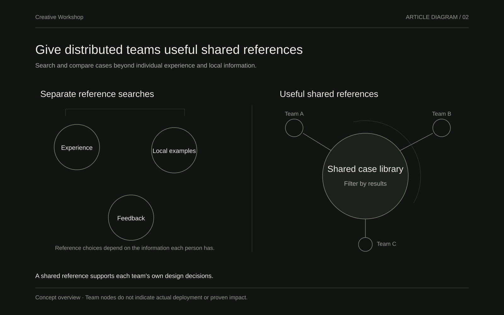
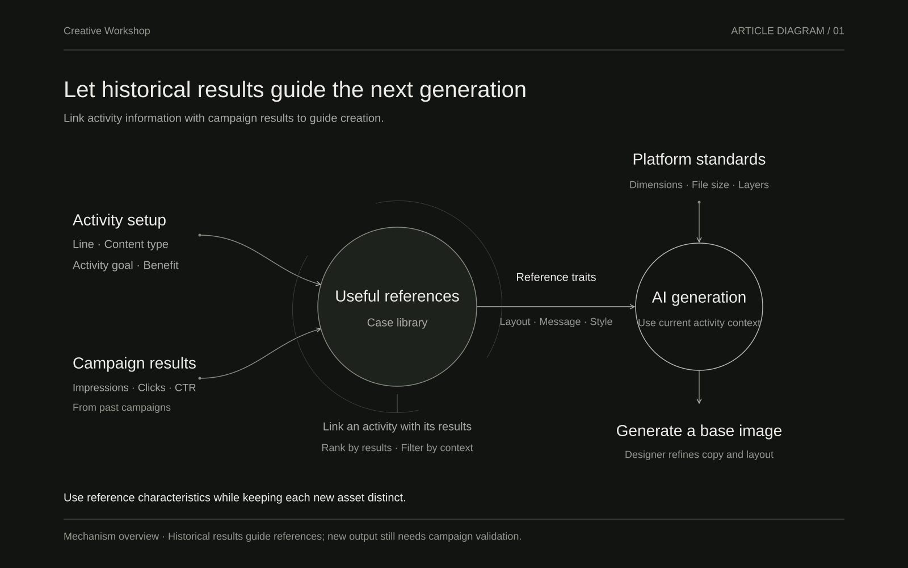
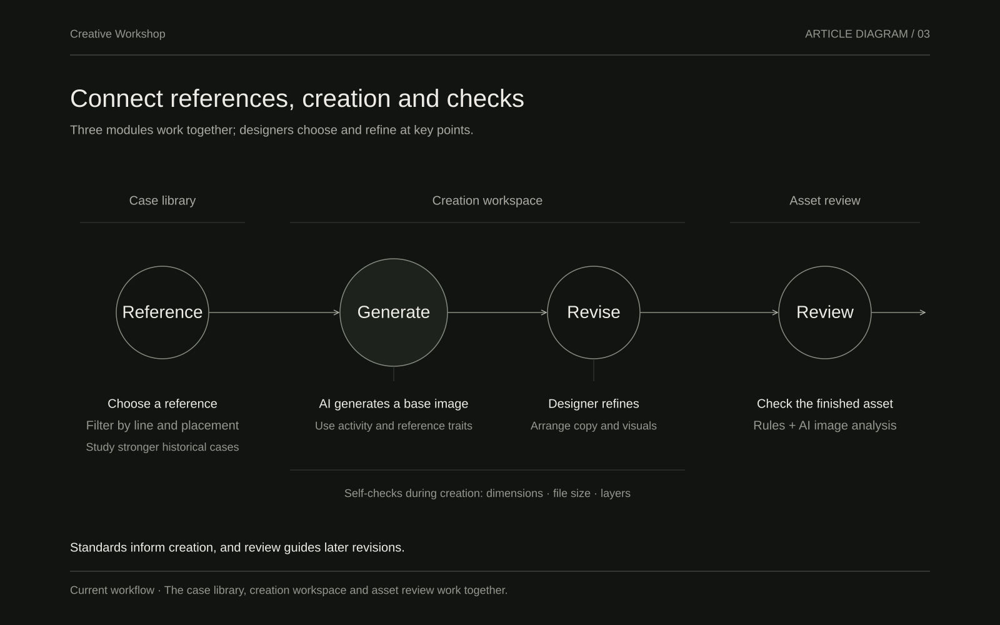
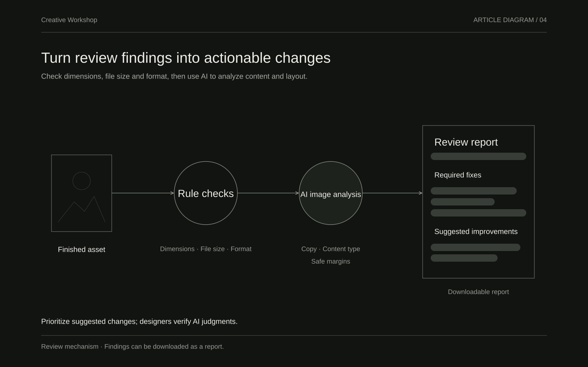
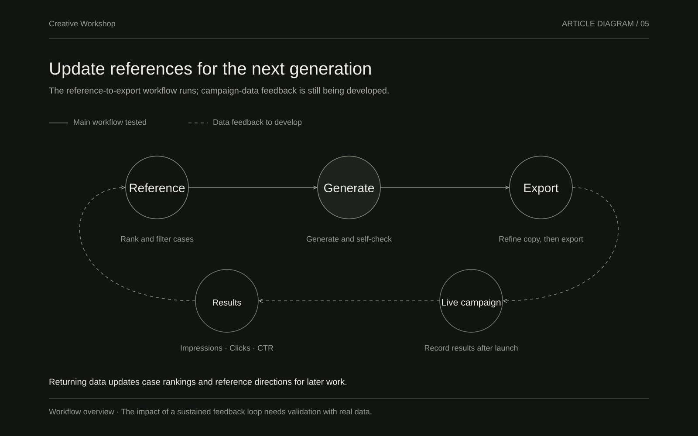

# Creative Workshop

Combining data and AI generation to reduce variation in global creative production

As global business expands, the way creative assets are produced is changing. Work once delivered by a centralized team is increasingly handled in parallel by operations designers across countries and regions. This improves responsiveness but also introduces systematic variation: inconsistent application of standards, experience that is difficult to share, and fluctuating campaign results. Creative Workshop explores how linking activity data with performance data can guide AI generation, helping distributed teams produce assets with visual quality and the potential for positive performance more consistently.

## 1. The problem is a lack of shared, useful references

International business spans many product lines and asset types, with frequent requests for placement assets, especially Super App pop-ups. Operations designers are spread across teams worldwide. Their understanding of standards, judgment of visual quality, and emphasis on business goals differ. Similar assets can therefore vary considerably: some are visually polished but have inconsistent click-through rates, some are rejected by platform review after overloading the message with benefits, and others go through repeated revisions because useful references are missing.

More fundamentally, most people do not have a clear view of which assets perform better in real campaigns. High-CTR examples are scattered, and weaker examples lack systematic review. Designers and operations staff often rely on limited personal experience or fragmented post-launch feedback. That stretches the path from an idea to a launch-ready asset and makes overall results harder to keep within a predictable range.

Give distributed teams a shared set of useful references

## 2. Connect visual quality with performance evidence

Creative Workshop follows a clear principle: generated assets should combine visual quality with the potential for positive performance. The aim is to establish a practical connection between the two, rather than pursue appearance or metrics in isolation.

To support this, we combine two previously separate sources of data:

- The activity-configuration platform supplies structured information such as business line, content type, activity goal, and benefit message.

- The data platform supplies actual post-launch performance, including impressions, clicks, and CTR.

The combined data serves two purposes. It supports ranking and filtering in the case library, making stronger historical examples easier to find. It also guides AI generation toward patterns that have performed relatively well, alongside design and platform standards. Reference cases provide direction and characteristics, rather than an image to copy, preserving variation in each new creative output.

**Additional view · Decision matrixExpand to see historical results and sample sizes**

**Decision matrix | Compare content directions within a placement**

Historical CTR and sample sizes help inform reference selection. Compare within each row, with caution around small samples. Red cells flag system-notification imitations that should be excluded. The original product interface is shown in Chinese.

Let historical performance inform the next generation

## 3. Turn dispersed experience into a reusable workflow

Creative Workshop currently focuses on the frequent Super App pop-up placement, with an 840 × 1068 output size and a 500 KB file limit. It covers the main steps from finding references through generation to asset review, using three complementary modules.

Connect references, creation, and checks in one workflow

### Case library (data hub)

The library ranks historical assets by CTR and supports filtering by business line and placement, while distinguishing compliant and non-compliant examples. Its purpose is to make relatively effective assets searchable and comparable. Designers and operations staff can observe recurring directions, such as leading with personal relevance, using status reminders, or expressing benefits with restraint, that have shown stronger click performance. This gives distributed teams a shared reference point beyond individual experience or local examples.

**Case library | Filter and compare historical assets**

Filter by business line and placement, then consider CTR, impressions, and clicks when choosing references. This is a historical snapshot through July 19, 2026; the figures come from past campaigns. The original interface is shown in Chinese.

### Generation workspace

In the generation workspace, users select a business line and content type and can use a high-CTR library case as a reference. AI then generates a base image for the required output, and the user adjusts the copy and layout. During creation, self-check prompts cover basic issues such as dimensions, file size, and layers, bringing common platform-review risks forward into the creative process. The key design choices are that a reference supplies direction and characteristics rather than a reusable image, and that self-checks embed explicit constraints in the workflow to reduce later rework.

**Editing workspace | Refine a sample asset and inspect self-checks**

Select a layout, adjust copy and illustration layers, review self-check results, and export in one workspace. This screenshot shows a sample being edited; the image-generation service was disconnected when it was captured. The original interface is shown in Chinese.

### Asset review

Review works on finished assets. The system first checks rules such as dimensions, file size, and format. AI then analyzes the image, identifies its copy and content type, and checks areas such as safe margins. Findings are grouped into required fixes and suggested improvements, with a downloadable review report. The intent is to automate checks that can be brought forward from platform review and provide clear reasons for changes, beyond a simple pass or fail.

Turn review findings into actionable changes

## 4. Key design decisions

The value of Creative Workshop lies in how data and standards participate in generation. Connecting an image model is only one part of that work. Several design decisions have been particularly important.

First, focus on Super App pop-ups. The placement is used frequently and has relatively clear dimension and file-size requirements, making it a useful starting point for collecting data and testing generation. Covering too many placement types from the outset would spread both data and standards too thinly to establish useful references.

Second, prioritize linking the data. Generation without performance evidence can remain visually plausible while its campaign results are unknown. Linking activity configuration with actual performance gives library ranking and generation guidance a meaningful basis. Data is still limited, so the design distinguishes the workflow already tested from the parts that need further performance-data feedback.

Third, bring standards and self-checks forward. Dimension mismatches, oversized files, and insufficient safe margins are more costly to discover during a late review. Surfacing them during creation and asset review can reduce platform rejections and repeated revisions. Structured review reports also make the suggested changes easier to act on.

**Design rules | Turn experience into actionable guidance**

Rules state their applicable conditions, recommended actions, and supporting evidence, with evidence-strength labels to help designers choose a direction before creating. The original interface is shown in Chinese.

Finally, keep the current stage in perspective. The project remains early. Its main workflow—reference selection, AI generation, self-check prompts, and export—can run end to end. The library also includes some test data with ranking and filtering. With limited real campaign data, this is not yet a complete feedback loop; space for that feedback has been left in the workflow and data interfaces.

## 5. Current state and the path to a feedback loop

The main path from reference selection to export has been tested. The library supports basic ranking and filtering, and review can perform rule checks and AI image analysis. These capabilities can support designer trials within the available test data. The project is still in testing, however, and limited post-launch performance-data feedback remains its main constraint.

The next priority is to expand data imports and gradually complete the loop. Exported assets enter real campaigns; their results return to the library and inform the reference directions and constraints used for later generation. Only a sustained loop could systematically reduce variation across distributed teams beyond individual tool use. As data accumulates, broad guidance may also develop into more specific pattern recommendations.

Give the next generation updated campaign references

## 6. Closing

Creative Workshop aims to turn experience scattered across teams and evidence gathered after launch into shared references and guidance for generation. As global creative production becomes more distributed, this offers a possible way to reduce systematic variation: give teams a common set of useful references, while allowing visual quality and potential campaign performance to inform creation from the start. Designers retain responsibility for judgment.

This is still an early project, with limited data and an incomplete feedback loop. The main workflow has been tested and the approach to linking the data is clear. More real data and a stronger generation–campaign–feedback–refinement cycle could allow this method to extend from one placement to a broader range of creative production, offering distributed teams a more consistent process that can continue to evolve.
