# Creative Workshop

**Designing across distance: using AI to address a global production problem previously out of reach**

> **Project overview**
> Project: Creative Workshop, an AI tool for international campaign assets such as splash screens, pop-ups, and banners, combining a case library, generation workspace, and asset review.
> Role: Built independently, from finding the problem and working with product and data teams to connect the data, through product design and implementing a usable prototype with AI.
> Context and results: Around 12 business teams produce assets across Brazil, Mexico, Japan, Australia, and other markets. A shared ID connected asset configuration to campaign performance record by record for the first time in this exploration. The library ranks by CTR (one example pop-up reached 10.76%); a sample pop-up passed 13/13 self-checks. The project is early and can be used at a basic level.

## Non-compliant assets were among the most clicked

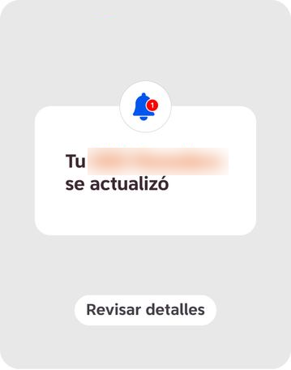

These assets resemble system messages or status reminders, and some invite accidental clicks. None meets the design standards.

Yet they were among the strongest performers in real campaign click data. Their numbers encouraged repeated reuse across business teams.

The story starts earlier.

## How far does one asset travel?

A placement is a space for campaign content in an app: splash screens, pop-ups, or banners. Making an image for one sounds small, but international operations multiply the difficulty.

### First, there are many teams

Around **12 business teams** produce these assets for Brazil, Mexico, Japan, Australia, and other markets. Each handles requirements, production, and launch internally, without a clear sharing mechanism between teams.

### Second, the makers change

Assets mainly come from business **marketing teams or outsourced design teams**. Platform-wide assets are handled by the platform business team. Staffing and skill levels at vendors vary, so a new group may produce a different visual result. Overall design quality is largely a **black box**.

### Third, markets differ

Christmas illustrations may show **snow and winter clothes in the northern hemisphere**, while **Australia celebrates in summer**. The familiar **OK hand gesture** can be **offensive in Brazil**. An image that works in one market can fail in another.

### The fourth layer is harder to notice

Even after production, it is difficult to know whether an asset works. Configuration lives in the **operations platform**, while performance lives in **another data system**. No one has a complete view **from configuration to results**.

Assets are made and launched far away. The design team sees only a small part of the process. Before AI, addressing the whole problem from design alone was largely out of reach.

## Designers originally had standards to hand out

The design team's role was to write standards: dimensions, file size, safe margins where text must not appear, information hierarchy, and visuals that might resemble system pop-ups. Successive versions became more detailed and were distributed to business teams, then to vendors and marketing. The hope was that compliance would improve the product experience.

In practice, people rarely read them. Even when they did, wrong dimensions, oversized files, and text in safe margins persisted. Users saw flawed assets or work was returned, sometimes by operations and sometimes by the existing online AI asset-review tool.

> Detailed standards still travel in only one direction. They do not necessarily reach the person actually making the image thousands of miles away.

## The first thought was to generate with AI

My first thought was generation too. If people could not remember the rules, AI could, making compliant images from the start.

On reflection, that was insufficient. Following standards addresses compliance and appearance. For the product, **a compliant asset nobody clicks is not much better than a flawed one**. Faster generation alone does not resolve the underlying problem.

## Where was the actual gap?

Operations staff request assets and select images; their concern is performance and clicks. Design cares about the user experience and visual quality.

That clarified the next step: connect both through AI. First the data, then the visual judgment.

## Find the complete data first

Research showed that international campaign images pass through the **campaign configuration platform**, called the operations platform below, before launch. It records the target country, audience, activity, and other settings.

I initially assumed finding this platform would give me everything. Its product manager explained that it contained configuration, including country, region, and audience, but no post-launch performance.

The **data team** held performance information. I asked for an export of some campaign data. This required effort, and the initial export is only a small fraction, enough to demonstrate and test the connection.

How could records from the two systems be matched? Through discussion with both teams and AI-assisted field exploration, we found a **shared ID** linking configuration to results record by record. I could finally see an asset's data from setup through performance.

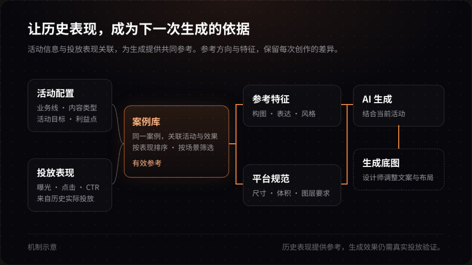

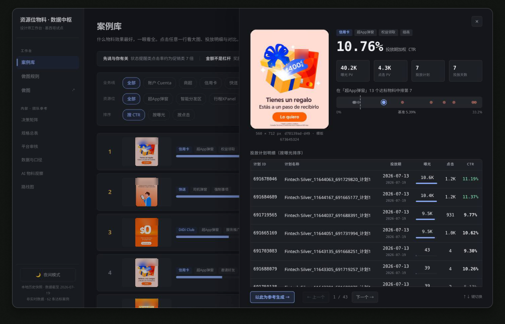

**Figure 01 · Case detail:** A pop-up's CTR, impressions, clicks, ranking within its placement, and campaign plans together. This is a local historical snapshot through July 19, 2026.

I had assumed the company had one platform where all this was visible. Going through the process showed that it did not.

Connecting systems like these usually requires coordination among data engineering, product, and design. Here, one designer used AI to test the connection on a small sample first.

## Visual quality does not guarantee performance

With the data connected, I compared images and campaign results to find assets that combined visual quality with strong performance.

The first discovery was the problematic group shown at the start: non-compliant images at the top of the click ranking. It was surprising.

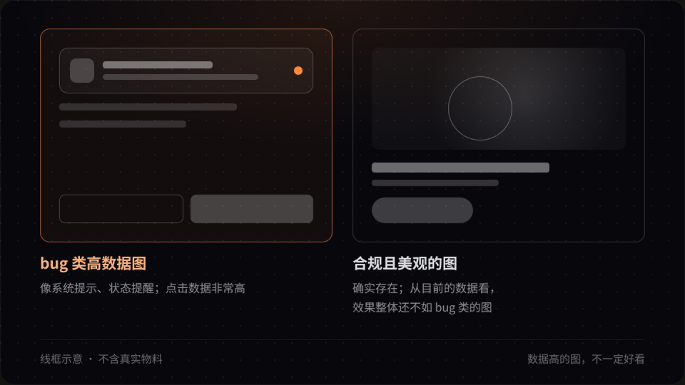

High click numbers alone were clearly insufficient as a selection rule.

There were also attractive, well-performing examples. I used AI to analyze those assets alongside their results, identify common visual patterns, and feed those patterns back into generation. Judgments about good assets now had data behind them, beyond one designer's or one small team's experience.

In the available data, these assets still tended to perform below the problematic ones. That may help explain why the less attractive, non-compliant patterns persist.

Conversations with operations staff and makers revealed another habit: copy another team's high-performing image and change a few words. They wanted similar results and some confidence in the choice.

This filled in the data side of the problem.

Generation now looked different. Previously, AI could only guess from the standards or my taste. With configuration and results connected, and patterns identified among attractive, effective examples, generation had a basis: which references to use, which pitfalls to avoid, and how to check the output.

That led to Creative Workshop.

## Creative Workshop

It combines a case library, generation workspace, and asset review across different placements. The following example uses a pop-up measuring 750 × 632, with a file limit of 500 KB.

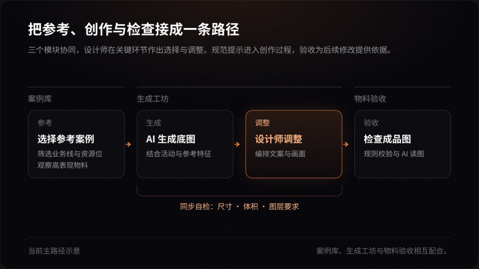

### Case library

Historical assets are ranked by CTR, with business and placement filters and a distinction between compliant and non-compliant examples. More effective images become searchable and comparable.

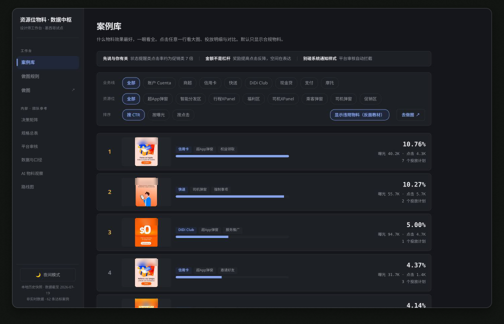

**Figure 02 · Case library:** Rank by CTR and filter by business line or placement. Only compliant assets appear by default; non-compliant ones can be opened separately as counterexamples.

### Generation workspace

The workspace references strong historical examples under comparable configuration conditions. AI generates a base image without copy; a person adjusts text and layout while dimensions and file size are checked.

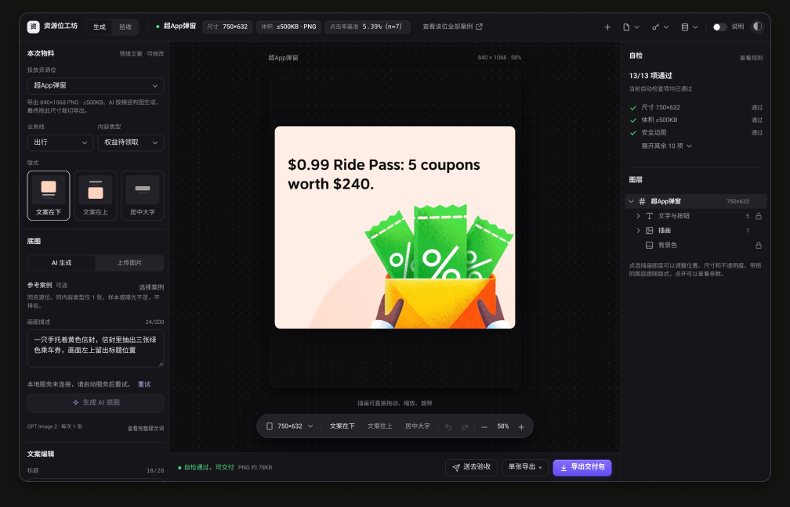

**Figure 03 · Generation workspace:** Placement, reference selection, and text editing on the left; an editable illustration canvas in the middle; specification and prohibited-pattern checks on the right.

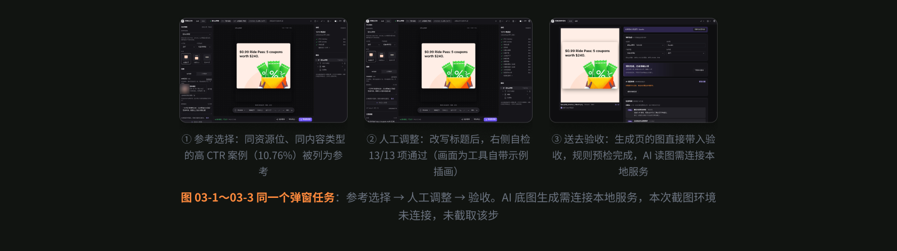

① Choose a reference: a high-CTR case (10.76%) with the same placement and content type.

② Adjust manually: after editing the title, all 13/13 self-checks pass. The image uses the tool's built-in sample illustration.

③ Send for review: the current image goes directly into review. Rule prechecks finish; AI image analysis requires a connection to the local service.

**Figures 03-1–03-3 · One task:** Reference selection → Manual adjustment → Review. AI base-image generation requires the local service, which was not connected in this capture environment, so that step is not shown.

### Asset review

Review handles assets made elsewhere too. It checks deterministic rules first, then uses AI to read the image and provide required fixes and suggested improvements in a downloadable report. The existing online review tool mainly intercepts problematic images; this review spans dimensions and file size through content.

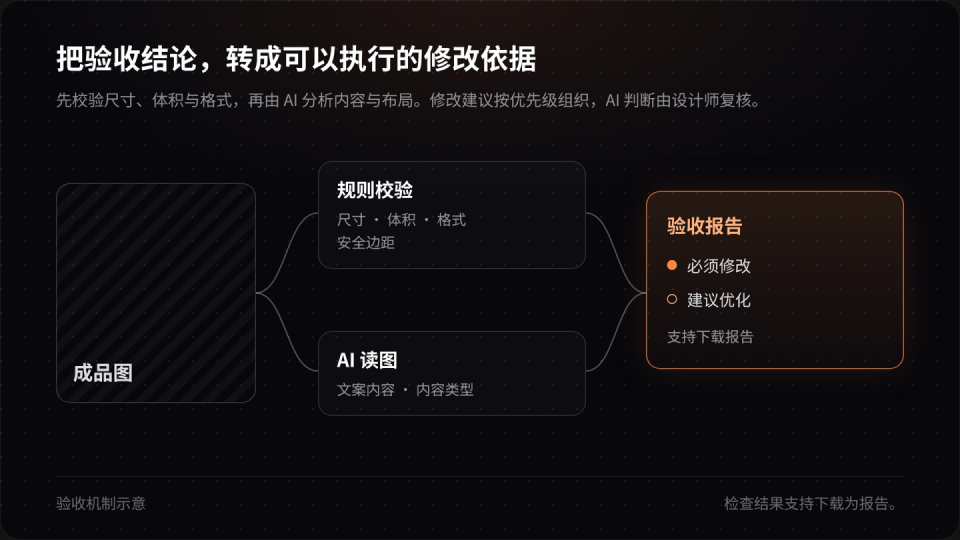

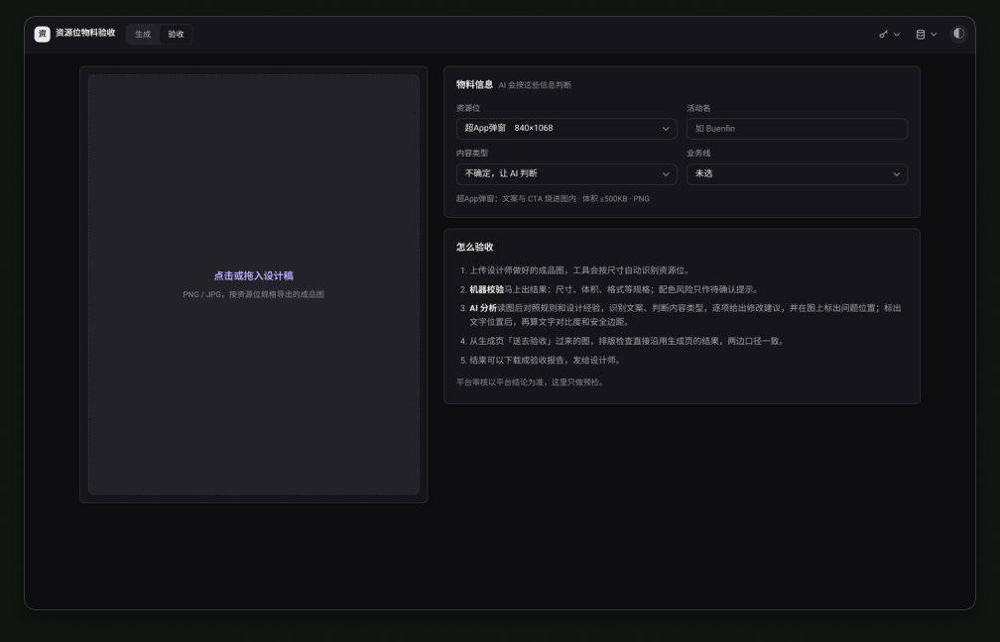

**Figure 04 · Asset review:** Upload a finished image. Programmatic checks verify dimensions, file size, and format; AI analyzes the image and suggests changes. Findings can be downloaded as a review report.

The design team's standards now become checks and rules within generation and review. Users choose their placement, while the relevant standards and data-derived guidance are integrated behind generation for AI to follow.

**For makers**, useful references are easier to find, and colleagues without a design background have a clearer starting point.

**For operations**, image selection can consider performance under similar campaign conditions.

**For review**, some standards checks happen earlier, allowing problems to be found before submission and reducing avoidable rework.

## Still early

An image-generation model has been connected, a small dataset analyzed, and standards for different placements imported. The project can be used at a basic level.

Next, I will improve the data and rules and select a small business task for internal testing.

AI image analysis needs testing with known problematic images to identify misses and false alarms. Small campaign trials with operations and data teams should then examine conversion and accidental clicks alongside CTR.

The goal is to import more data, generate usable assets, run them in real campaigns, and return performance to the library to guide subsequent generation.

That would move the product beyond a demo toward practical business value.

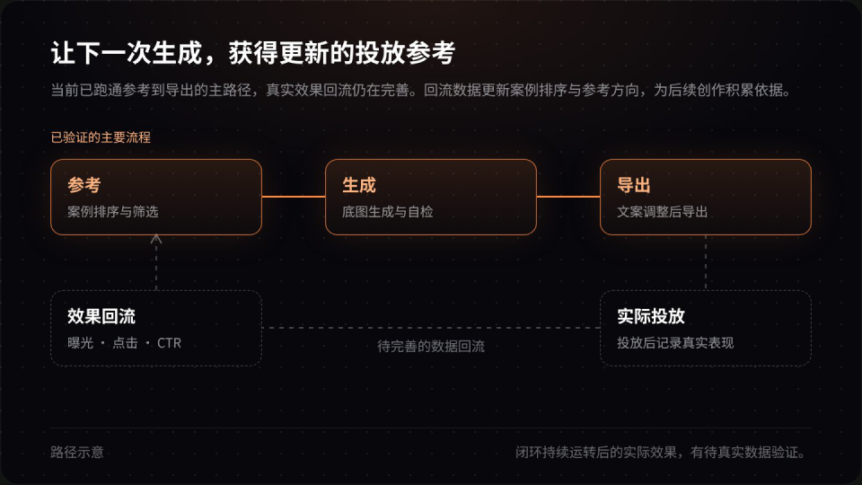

## AI extends a designer's reach

The question throughout has been what campaign images actually do for the business.

To understand it, I approached a team I had not worked with, requested data design normally would not use, found matching IDs across systems, and asked makers why they copied particular images.

Previously, this would have required assembling a small team and scheduling the work. With AI, I could first explore whether the path was viable myself.

Designers often describe being at the end of the business process: receive requirements, deliver an asset, then lose sight of the outcome. This year, AI has helped me follow an image forward into its results and back into the business reasons behind it, then bring those findings to the next design. Visual quality can be grounded in actual business context and evidence.

## Tools are changing faster

AI in 2026 changes rapidly, with successive models, tools, and ideas. In the comparison shown below, intervals before the next GPT generation replace the earlier one have fallen from roughly one or two hundred days in the GPT-4 and GPT-4o era to tens of days, with the shortest about a week. A tool learned today may change next month, giving rise to the joke that if you learn slowly enough, you need not learn it at all.

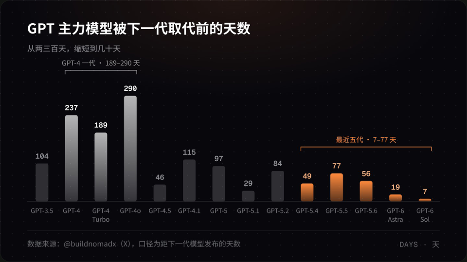

The real bottleneck is more often recognizing the problem than learning a particular tool. Systematic thinking and judgment survive model changes; faster tools make those abilities more valuable.

For a designer, that is what it means to have an impact across distance.
