# 资源位工坊

**决胜千里之外——一个设计师借助 AI，去解决过去解决不了的全球化难题**

> **项目概览**
> 项目：资源位工坊，面向国际化运营物料（开屏、弹窗、横幅等资源位上的图）的 AI 工具，由案例库、生成工坊和物料验收三部分组成。
> 角色：个人独立完成，从发现问题、对接产品与数据团队打通数据、方案设计，到借助 AI 实现可用原型。
> 背景与结果：约 12 个业务团队在做资源位物料，覆盖巴西、墨西哥、日本、澳洲等市场；通过一个共同 ID 第一次把物料的配置与投放效果逐条打通；案例库按 CTR 排序（示例弹窗 CTR 10.76%），生成的弹窗自检 13/13 项通过；项目处于早期，可初步使用。

## 这些图都不合规，却是点击率最高的一批

【插图 01：开头 bug 图 A】

【插图 02：开头 bug 图 B】

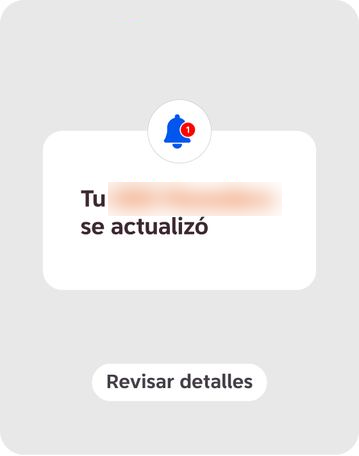

【插图 03：开头 bug 图 C】

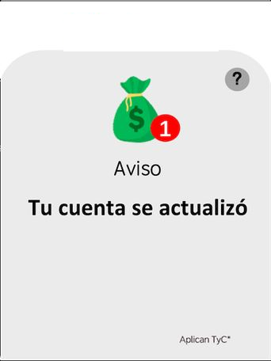

先看这几张图。它们看起来像系统提示、像状态提醒，有的很容易被误点。按规范，它们都不合格。

但在真实投放数据里，它们是点击率最高的一批，而且因为数据好，被各个业务团队反复使用。

这件事要从头说起。

## 一张图，要跨过多远的距离

资源位是 App 里展示运营活动的位置，开屏、弹窗、横幅都算，放上去的图通常叫物料。做一张物料，听起来是很小的事，但是放到国际化业务里，它面临的难度将会几何倍提升。

### 第一层是团队多。

目前大约有 **12 个业务团队**在做资源位物料，覆盖巴西、墨西哥、日本、澳洲等多个市场。每个团队从提需求、做图到上线都在自己内部完成，团队之间没有明确的共享机制。

### 第二层是做图的人不固定。

图主要来自各业务的 **Marketing team 或设计外包团队**，平台统一发出的物料由平台业务团队负责。外包团队的人员和水平又不稳定，换一批人，出来的图可能就是另一种样子。整体的设计质量，几乎是一个**黑盒**。

### 第三层是市场之间的差异。

圣诞插画在**北半球画雪花和冬装**，可**澳洲的圣诞正值盛夏**；插画里常见的**“OK”手势**，**在巴西可能被视为冒犯**。一张在这个市场没问题的图，换一个市场就可能出错。

### 第四层最难察觉。

就算图做出来了，也很难知道它到底好不好。活动配置在**运营平台**里，投放效果在**另一个数据系统**里，没有人能看到一张图**从配置到效果的全貌**。

图在千里之外被做出来、被投出去，设计团队能碰到的只有其中很小的一段。在 AI 出现之前，这件事几乎没法从设计这一侧解决。

## 设计师手里，原本只有规范

在原来的职能里，设计团队能做的就是写规范。尺寸、体积、安全区（画面边缘不能放文字的区域）、文字层级、哪些画面容易被误认为系统弹窗……一版比一版细，发给各业务团队，再交给外包和 Marketing 去执行。设计团队希望大家照着做，产品的效果就会好起来。

实际情况是行不通的。做图的同事很少去看；看了，也还是会犯错：尺寸不对、体积超限、文字压进安全区。结果要么是用户看到一张 bug 图，要么被打回返工，有时是业务运营撤回重做，有时是被线上的 AI 物料审核工具拦下。

> 规范写得再细也只能单向地发出去，影响不到千里之外真正动手的那个人。

## 有了 AI，第一个念头是让它来生成

AI 来了以后，我最先想到的也是生成：既然人记不住规范，就让 AI 记，生成出来的图天然合规。

仔细思考后觉得还是不够。让 AI 去执行规范，解决的仍然是合不合规、好不好看。对产品来说，**一张完全合规、但没人点的图，并不比一张 bug 图好多少**。生成只是把原来那件事做得更快，问题的根本并没有解决。

## 回头想，问题到底卡在哪

我开始回头看这件事的根本问题。业务运营负责提需求和选图，他们关心的是数据，这张图投出去点得多不多。设计这边关心的是用户体验和画面的美感。

想明白这一点，下一步就清楚了：用 AI 把这两件事都接起来。先是数据，再是美感。

## 先把数据找全

通过调研知道所有国际化运营图上线前，都要经过**运营活动配置平台**（下文简称“运营平台”）。每张图投给哪个国家、哪类人群、什么活动，以及其他配置信息都会在这里。

最开始我以为只要找到运营平台，数据就齐了。于是去找了对应模块的产品经理。聊下来才知道，平台里只有活动配置信息，国家、地区、人群这些；图上线后的数据表现怎么样这里并没有。

效果数据在**数据团队**那边。我又去找数据团队，请他们帮忙导出了一部分投放数据。这有工作量，目前导出的只是很小的比例，先用来做演示，把链路跑通。

两份数据来自两个系统，怎么一一对上？和两个团队来回沟通，再借助 AI 在两边的字段里梳理，最后找到了一个**共同的 ID**，把配置和效果逐条绑在一起。这样我第一次看到了一张物料图从配置到效果的完整数据。

【插图 04：概念图：数据链路】

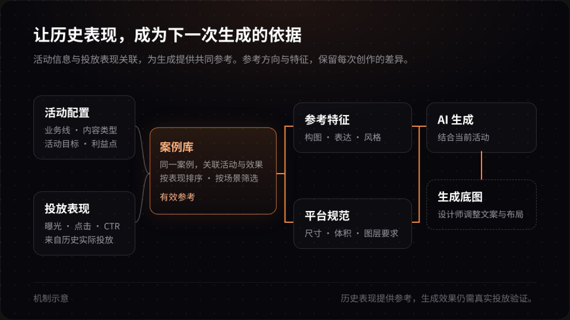

【插图 05：图 01 案例详情】

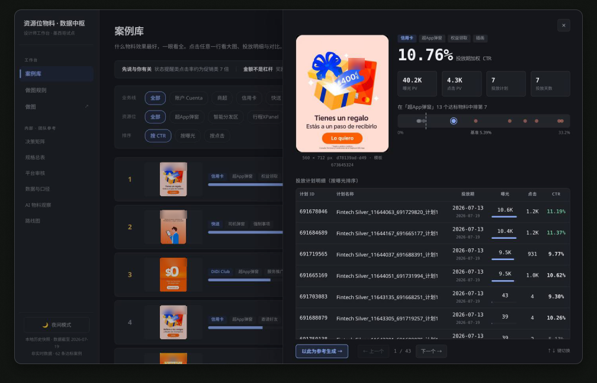

**图 01 案例详情**：一张弹窗物料的 CTR、曝光与点击、在同位物料中的排名和投放计划明细放在一起（本地历史快照，数据截至 2026-07-19）

在这之前，我一直以为公司有一个完整的数据平台，站在一个视角下就能把这些看全。真正走一遍才发现，并没有这样一个平台。

这类跨系统的打通，过去往往需要数据工程、产品、设计几方协作；这一次，一个设计师借助 AI 先跑通了一个小样本。

## 再看美感：好看的图，数据不一定好

数据接上之后，我把真实投放数据和图放在一起比对，想整理出既好看、数据又好的图。

第一眼就撞上了开头那批 bug 图：按规范都不合格，点击数据却排在最前面。当时挺震惊的。

【插图 06：概念图：美感与数据对比】

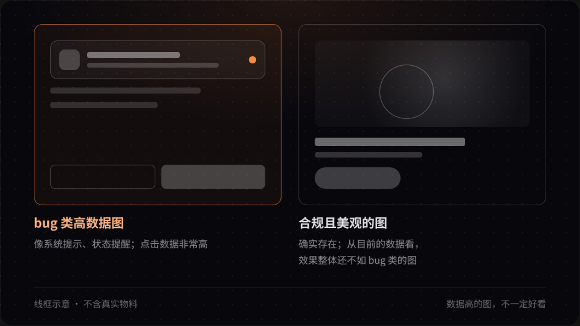

这也让我明白了，只看数据好的图，是不行的。

既美观、数据又好的图也确实存在。我用 AI 把这批图和它们的投放数据放在一起分析，提炼出它们在画面上的共同规律，再让这些规律反过来指导 AI 生成。这样一来，什么是好图，第一次有了数据撑腰，不再只靠某个设计师或者某个小团队的经验。

另外发现一件事，从目前的数据看，这类图的效果整体还是不如 bug 类的图。这可能也是这种并不好看的图屡禁不止的原因。

和业务运营、做图的同事聊下来，我还看到了他们的习惯：看到别的团队某张图数据好，就原图照搬，只改几个字。他们要的是同样的效果，心里有底。

到这里，数据这一半算是补上了。

回头再看最开始那个念头，用 AI 生成图，感觉就不一样了。之前让 AI 生成，它只能照着规范或者我的审美去猜什么是好图；现在我手里有了每张图从配置到效果的完整数据，也从里面整理出了好看、数据又好的那些规律。生成这件事终于有了依据：参考哪些图，避开哪些坑，生成之后怎么检查，都可以从数据里来。

基于以上，我做了一个新的 AI 产品——资源位工坊。

## 资源位工坊

资源位工坊由三部分组成：案例库、生成工坊和物料验收。它面向各类资源位，下面以弹窗（尺寸 750×632，体积 500KB 以内）为例。

【插图 07：概念图：参考、创作与检查一条路径】

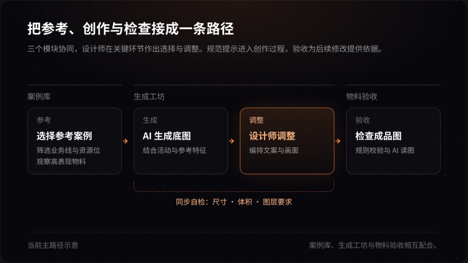

### 案例库

案例库把历史物料按 CTR（点击率）排序，可以按业务、资源位筛选，并区分合规与违规，让“什么图更有效”可以被找到、被对照。

【插图 08：图 02 案例库】

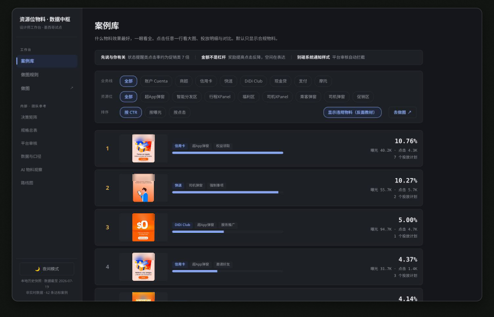

**图 02 案例库**：按 CTR 排序，可按业务线、资源位筛选；默认只显示合规物料，违规物料可作为反面教材单独打开

### 生成工坊

生成工坊会引用同等配置条件下数据好的图作参考，AI 先生成不带文案的底图，再由人调整文案和布局，同时自检尺寸、体积。

【插图 09：图 03 生成工坊】

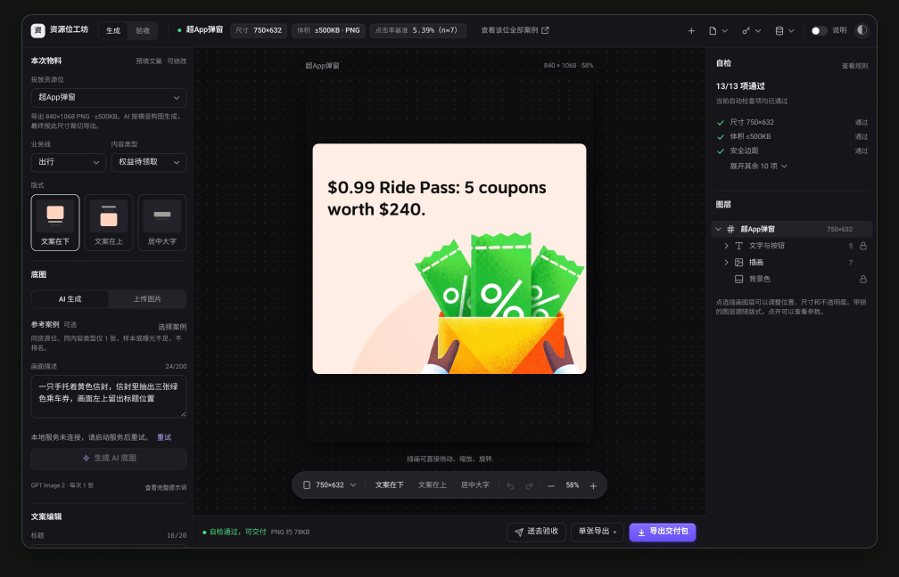

**图 03 生成工坊**：左侧选资源位、参考案例与编辑文案，中间画布可直接调整插画，右侧自检逐项检查规格与红线

【插图 10：图 03-1～03-3 三步合图】

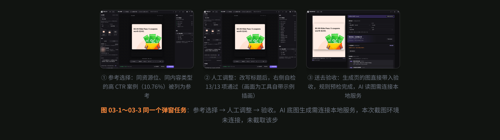

① 参考选择：同资源位、同内容类型的高 CTR 案例（10.76%）被列为参考

② 人工调整：改写标题后，右侧自检 13/13 项通过（画面为工具自带示例插画）

③ 送去验收：生成页的图直接带入验收，规则预检完成，AI 读图需连接本地服务

**图 03-1～03-3 同一个弹窗任务**：参考选择 → 人工调整 → 验收。AI 底图生成需连接本地服务，本次截图环境未连接，未截取该步

### 物料验收

物料验收用来检查在别处做好的图：先做规则校验，再由 AI 读图，按“必须修改”和“建议优化”给出建议，报告可以下载。线上已有的 AI 物料审核工具主要拦截 bug 类图，物料验收从尺寸、体积一直查到信息内容。

【插图 11：概念图：验收结论转成修改依据】

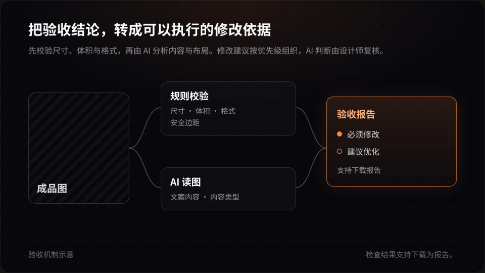

【插图 12：图 04 物料验收】

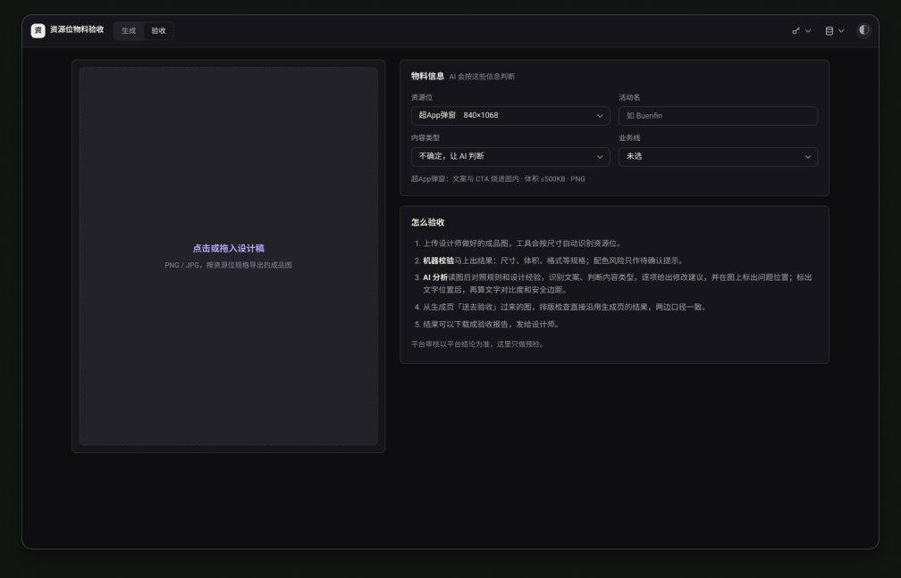

**图 04 物料验收**：上传成品图后，机器先校验尺寸、体积、格式，AI 再读图逐项给出修改建议，结果可下载为验收报告

初期设计团队制定的规范也有了用武之地，它变成了生成和验收里的自检和规则，真实的用户只需要选择他们所对应的资源位即可，所有的规范与数据总结出来的规则都会默认集成在生成的背后，由AI来直接完成。

**对做图的人**，能更快找到数据好的图做参考，非设计出身的同事也更容易上手；

**业务运营**选图时，能看到同样活动背景下哪张表现更好；

**审核这边**，一部分规范检查提前了，提交前就能发现不少问题，返工会少一些。

## 还在路上

项目还在早期。目前已接入图像生成模型，对小数量级的数据做了分析与沉淀，导入了不同资源位的规范，可以初步使用。

接下来会继续完善数据与规则，之后挑一个小范围的业务任务，请内部进行测试；

AI 读图这部分，拿已知有问题的图去测，看它漏了哪些、误报了哪些。之后再和业务、数据团队一起试小规模投放，除了点击率，也想办法看看后续转化和误触。

最想做成的是把更多数据导进来，生成真实可用的物料图，上线跑通，再让投放结果回到案例库，为下一次生成提供参考，形成正向飞轮。

让这个产品不再停留在 demo 阶段，而是真正能够给业务带来帮助。

【插图 13：概念图：投放结果回到下一次生成】

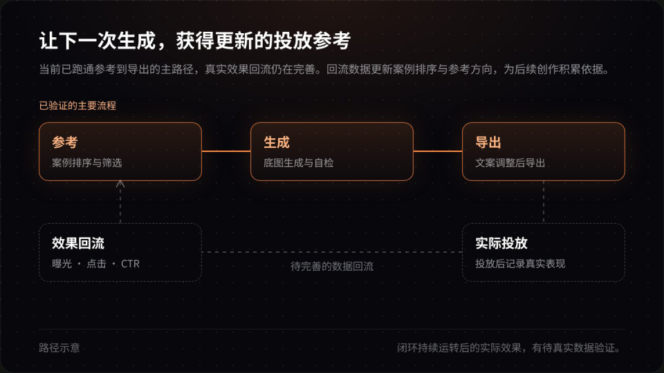

## AI 给设计师的，是更长的手

回头看这一路，起点其实一直是同一个问题：运营图到底帮业务做了什么。

为了弄清楚它，我找了一个从没合作过的业务团队，要来一份平时设计不会碰的数据，在两个系统之间找能对上的 ID，也去问做图的同事，当时为什么会照着一张图来做。

放在以前，想把这些串起来，得先拉一个小团队、排上工期。现在借着 AI，我自己就能先试一试，看这条路走不走得通。

设计师常吐槽自己在业务的末端，接需求、交稿，之后这张图怎么样了就不太知道。这一年我的感受是有了 AI，设计师能多做的那部分，恰好是业务用得上的：顺着一张图往后看它的数据，往前想业务为什么这么安排，再把看到的东西带回下一次设计里。让设计本身，体现了它真正的价值，不再是单一讲究美感，而是结合真实的业务与数据，让设计有据可依。

## 工具换得越来越快

2026年AI的变化越来越快。新模型、新工具、新理念一个接一个，GPT 主力模型从发布到被下一代取代的时间，GPT-4、GPT-4o 那一代还有一两百天，到 2026 年已经缩短到几十天，最短的只有一周左右。今天学会的工具，下个月也许就换了，对应了网上流传的那句，如果学得慢，那就不用学了。

【插图 14：概念图：GPT 主力模型寿命】

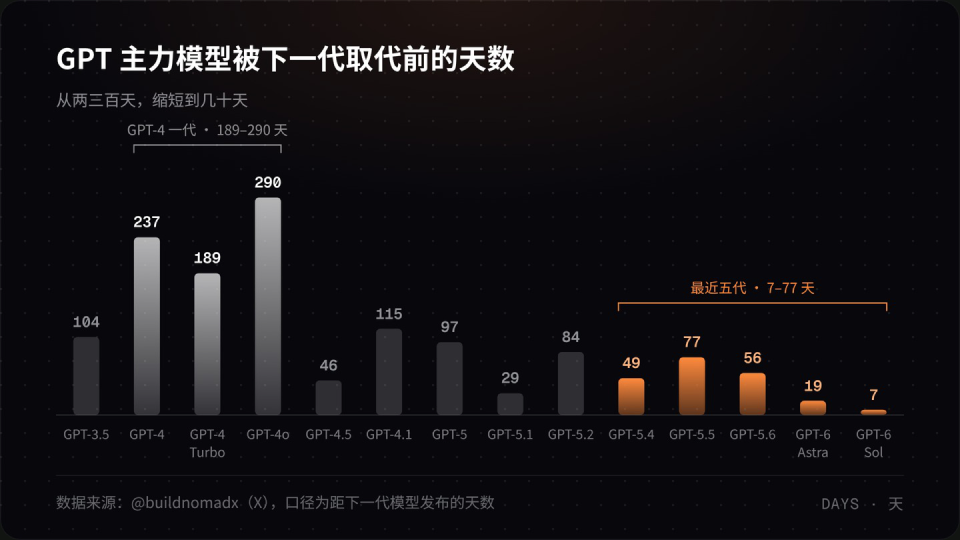

真正的瓶颈，从来不是会不会用哪个工具，更多的是知不知道问题出在哪儿，有体系的思考才是真正重要的。这些判断不会因为模型换代就失效，反而工具越快，越能体现价值。

所谓决胜千里之外，对设计师来说，大概就是这个意思。
