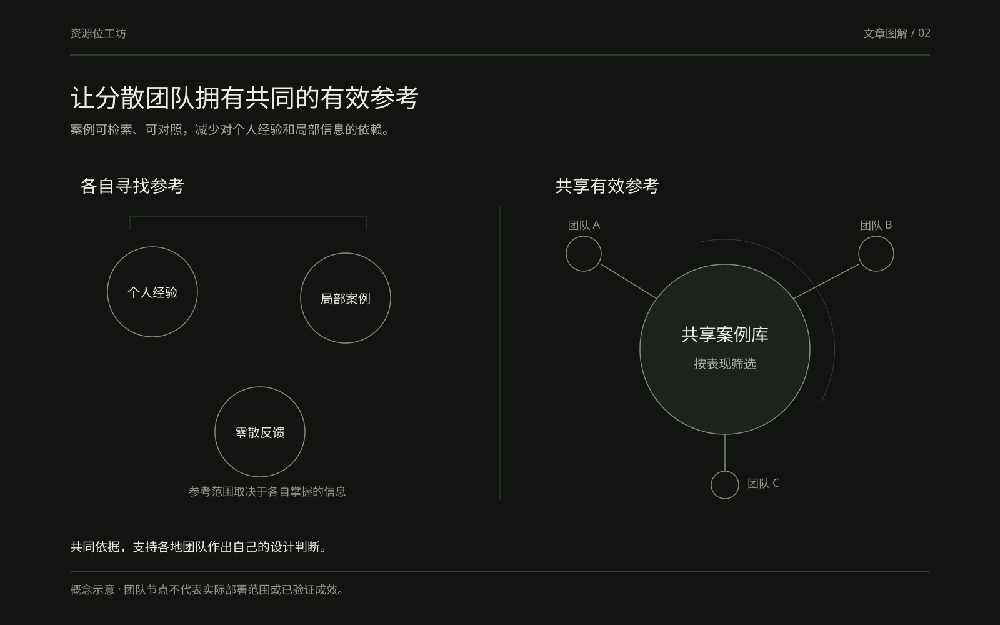
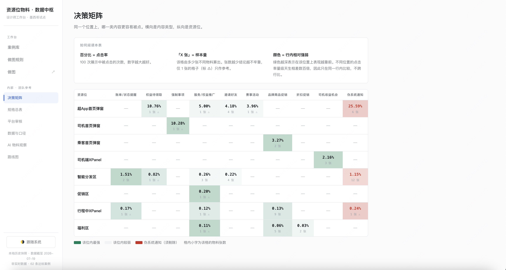
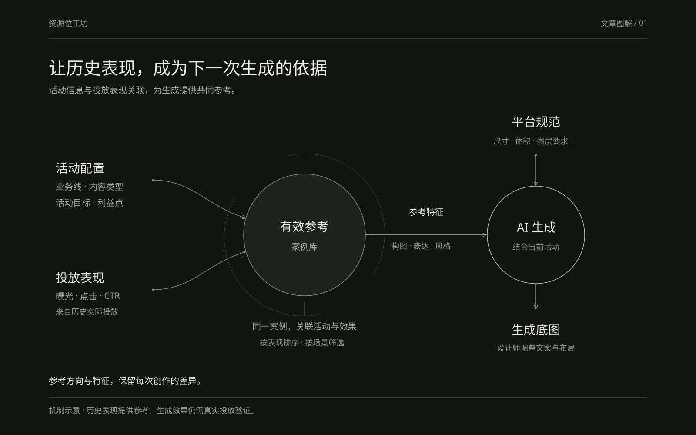
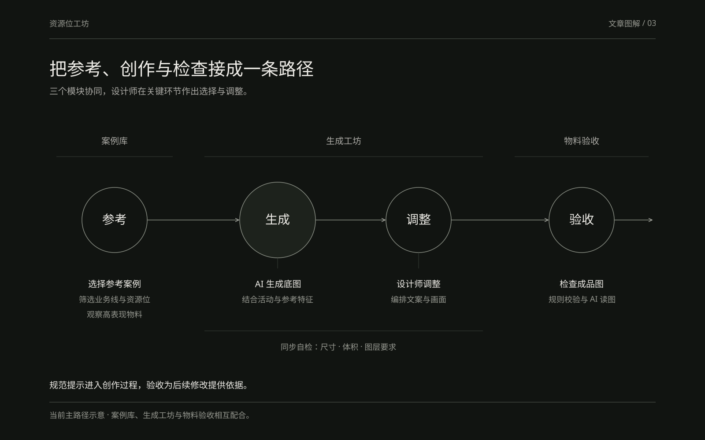
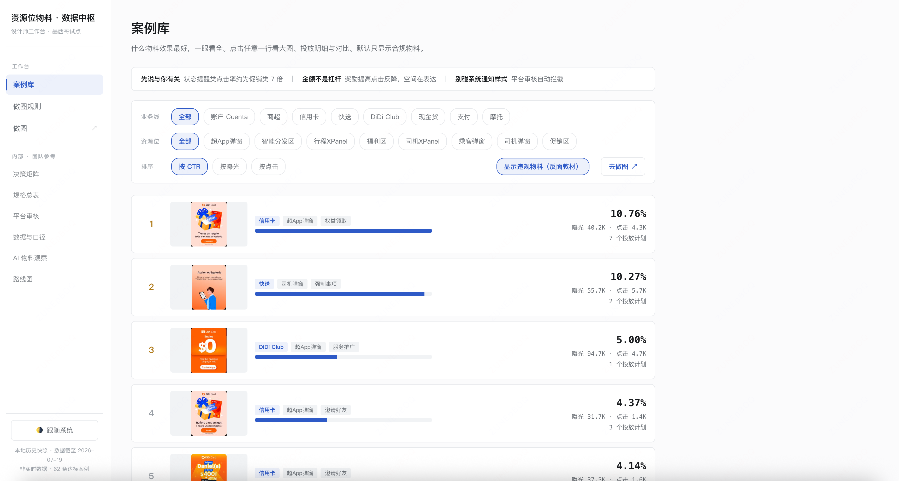
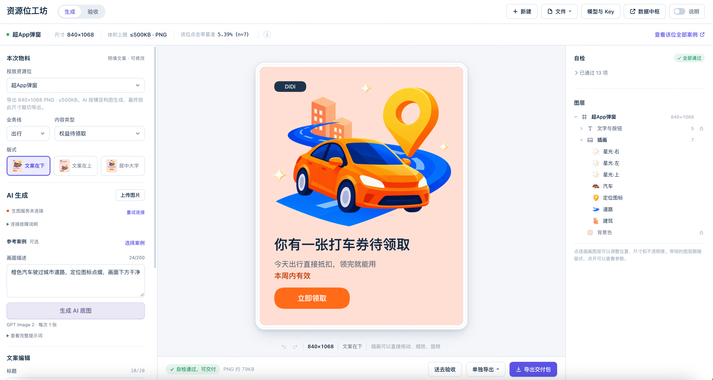
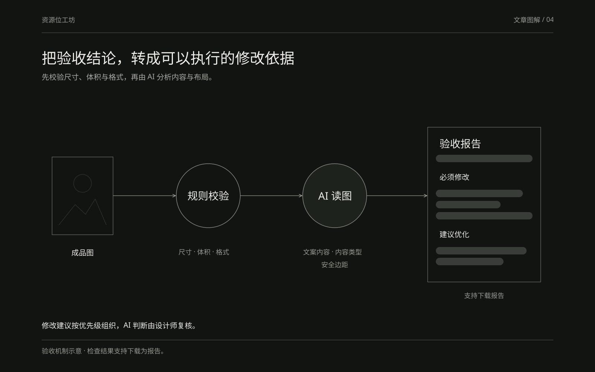
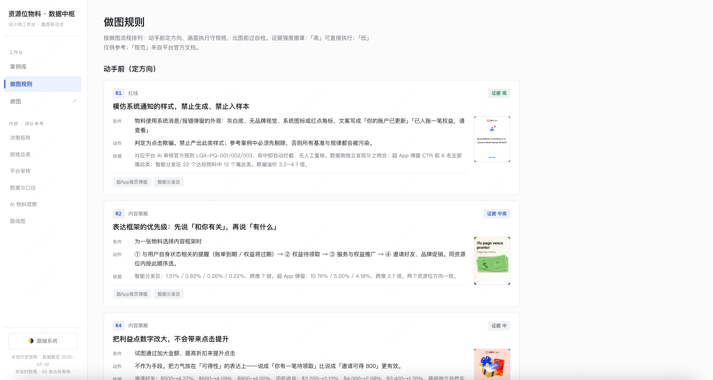
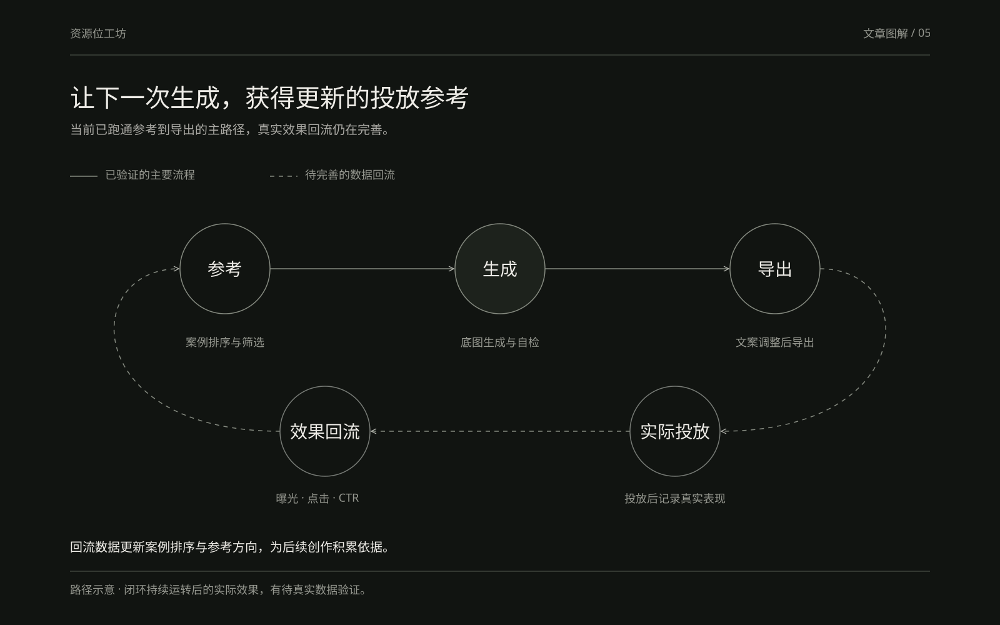

# 资源位工坊：用数据融合与 AI 生成，降低全球化创意生产的系统性方差

在全球化业务持续扩张的过程中，创意物料的生产模式正在发生变化。过去更多依赖集中团队统一输出，现在则越来越多地由分布在不同国家和地区的运营设计师并行完成。这种变化提升了响应速度，但也带来了明显的系统性方差：标准执行不一致、好的经验难以沉淀、投放效果波动较大。资源位工坊试图通过「活动数据与效果数据的融合」来约束 AI 生成过程，让分散的团队也能更稳定地产出既具备美感、又具备正向数据表现的物料。

## 一、问题不在于不会做图，而在于缺乏共同的有效参考

国际化业务线数量多、类型杂，资源位物料（尤其是超 App 弹窗）的需求高频出现。负责设计的运营设计师分散在全球不同团队中，他们对规范的理解、对「好图」的判断、对业务目标的侧重并不完全一致。结果是同一类物料在不同团队手里呈现出较大差异：有的视觉完成度高但点击率不稳定，有的试图堆砌利益点却被平台审核打回，有的则因为缺乏参考而反复修改。

更根本的问题是，大多数人并不清楚什么样的物料在真实投放中表现更好。高 CTR 的案例散落在各处，低效案例也缺少系统性的复盘。设计师和运营往往只能依赖有限的个人经验，或在投放后根据零散反馈进行调整。这种模式使得从创意到可投放物料的周期被拉长，整体效果也难以稳定在一个可预期的区间内。

## 二、核心原则：生成结果要同时具备美感与正向数据表现

资源位工坊的设计原则很明确——生成的物料不能只追求视觉完成度，也不能单纯追逐数据指标，而要在两者之间建立可执行的连接。

为实现这一点，我们把两个原本相对独立的数据源进行合并：

- 活动配置平台提供活动的结构化信息，包括业务线、内容类型、活动目标、利益点等；

- 数据中心平台提供该活动上线后的真实表现，包括曝光、点击、CTR 等。

合并后的数据同时服务于两个用途：一是作为案例库的排序与筛选依据，让高表现物料可以被优先看见；二是作为 AI 生成时的方向约束，使生成过程不再只是「根据文字描述出图」，而是「在历史上表现较好的模式附近，结合规范要求进行生成」。参考案例的作用是提供方向和特征，而非直接复制画面，以保持结果的差异性。

补充界面 · 决策矩阵

同时展示历史点击率和样本量，辅助选择参考方向。不同资源位按行内比较，少量样本保留参考边界；红色标记需剔除的仿系统通知素材。

## 三、资源位工坊：把分散经验转化为可复用的生成能力

资源位工坊当前聚焦超 App 弹窗这一高频资源位（尺寸 840×1068，体积上限 500KB），覆盖从参考、生成到验收的主要环节。它由三个相互配合的模块构成。

### 案例库（数据中枢）

案例库将历史物料按 CTR 进行排序，并支持按业务线、资源位进行筛选，同时区分合规与违规物料。它的设计目标不是展示所有历史素材，而是让「什么是相对有效的图」变得可检索、可对照。设计师和运营可以快速观察到一些反复出现的模式，例如「先说与你有关」「状态提醒类」「利益点表达克制」等方向往往具有更高的点击表现。通过这种方式，分散在各地的团队第一次拥有了相对统一的有效参考，而不再完全依赖个人经验或局部案例。

按业务线和资源位筛选案例，结合 CTR、曝光与点击量选择参考。截图为截至 2026-07-19 的历史快照，数值来自历史投放。

### 生成工坊

在生成工坊中，用户首先选择业务线与内容类型，然后可以引用案例库中的高 CTR 物料作为参考。AI 在此基础上生成符合尺寸与体积要求的底图，用户再对文案布局进行调整。生成过程中会同步给出自检提示，涵盖尺寸、体积、图层规范等基础问题，尽量把平台审核中常见的风险前置到创作阶段。这里的关键设计考量是：参考案例提供的是方向和特征，而不是可直接复用的画面；自检则负责把明确的规范约束嵌入流程，减少后续返工。

在同一工作台选择版式、调整文案与插图图层，查看自检结果并导出。截图展示样例物料的编辑状态，截取时生图服务未连接。

### 物料验收

验收环节面向已经完成的成品图。系统首先进行规则校验（尺寸、体积、格式等），再由 AI 进行读图分析，识别文案内容、判断内容类型、检查安全边距等，并按「必须修改」和「建议优化」分组输出结果，支持下载验收报告。这一模块的设计意图是把平台审核中可前置的检查尽可能自动化，同时为设计师提供清晰的修改依据，而不是简单的通过/不通过判断。

## 四、关键设计决策

在 AI 创新的语境下，资源位工坊的价值不在于单纯接入生成模型，而在于数据与规范如何共同参与生成过程。以下几个决策较为关键。

首先，选择先聚焦超 App 弹窗。这一资源位使用频率高，尺寸与体积要求相对明确，适合作为数据积累和生成能力验证的起点。如果一开始覆盖过多资源位类型，数据和规范都会变得稀疏，难以形成有效的参考。

其次，坚持数据融合优先于单纯生成。没有效果数据支撑的生成，很容易停留在「视觉上可行但投放表现未知」的状态。把活动配置信息与投放表现合并后，案例库的排序和生成时的方向约束才具备实际意义。当前阶段数据量仍然有限，因此在设计上明确区分了「已验证的流程」和「待数据回流后完善的部分」。

第三，把规范和自检尽可能前置。尺寸不符、体积超限、安全边距不足等问题，在后期审核中发现的成本较高。在生成和验收阶段就暴露这些问题，可以减少平台打回和反复修改的次数。同时，验收报告的结构化输出也让修改建议更加可执行。

将规则组织为适用条件、执行动作与依据，并标注证据强弱，帮助设计师在动手前确定方向。

最后，对当前阶段保持克制。项目仍处于前期，主流程已经能够跑通（参考案例、AI 生成、自检提示、导出），案例库也已接入部分测试数据并支持排序与筛选。但由于真实投放数据量较少，我们没有把现有能力包装成完整闭环，而是在流程和数据接口上为后续回流预留了空间。

## 五、现状与闭环路径

目前资源位工坊已完成从参考到导出的主要路径验证，案例库具备基础的排序与筛选能力，验收环节也能完成规则校验与 AI 读图分析。这些能力在测试数据范围内已经可以支持设计师进行尝试。然而，由于整体仍处于测试阶段，真实投放后的效果数据回流有限，这是当前最主要的约束。

下一步的重点是扩大数据导入范围，并逐步形成闭环：物料生成并导出后进入实际投放，投放后的效果数据回流至案例库，进而影响后续生成时的参考方向和约束条件。只有这一闭环持续运转，分散团队之间的质量方差才有可能被系统性压缩，而不是停留在单次工具使用的层面。同时，随着数据积累，生成约束也可以从相对宽泛的方向指引，逐步细化为更具体的模式推荐。

## 六、结语

资源位工坊并不旨在取代设计师的判断，而是试图把原本散落在各团队的经验和事后验证，转化为可共享的数据参考与生成约束。在全球化创意生产日益分散的背景下，这种方式提供了一种降低系统性方差的路径：让更多团队能够在相对统一的有效参考下工作，并在生成阶段就兼顾视觉完成度与数据表现的可能性。

当前仍是早期阶段，数据量有限，闭环尚未完全跑通。但主流程已经验证，数据融合的逻辑也已明确。随着更多真实数据的接入，以及「生成—投放—回流—优化」循环的完善，这一方法有机会从单一资源位扩展到更广泛的物料生产场景，为分布式团队提供一种更稳定、可演进的创意生产方式。
